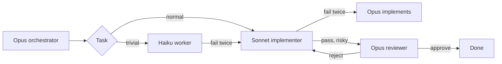

# 🎚️ cc-tiers

### Opus plans. Sonnet builds. Haiku does the small stuff.

A Claude Code plugin that keeps each task on the cheapest tier that can finish it, then escalates with the failure notes attached.

[](https://claude.com/claude-code)
[](#-install)
[](LICENSE)

**English** · [Português](README.pt-BR.md)

⚡ three native agents  •  🔁 two failures, then escalate  •  ⚙️ rules live in `/config`

---

## 🚀 Install

At the prompt of a Claude Code session, once this repo is the marketplace `edsoncantuaria/cc-tiers`:

```
/plugin install cc-tiers --marketplace edsoncantuaria/cc-tiers
```

> [!TIP]
> Answer `y` to add the marketplace, then pick a scope. The next session starts on the Opus orchestrator — nothing else to install.

To try a local checkout without publishing:

```bash
git clone https://github.com/edsoncantuaria/cc-tiers
claude --plugin-dir /path/to/cc-tiers
```

---

## 🔎 Who does what

| Tier | Agent | Model | Does |
| :-: | --- | --- | --- |
| Plan | `cc-tiers:orchestrator` | Opus | Splits the request, delegates, and implements only the ceiling |
| Default | `cc-tiers:implementer` | Sonnet | Features, bug fixes, tests, local refactors |
| Trivial | `cc-tiers:worker` | Haiku | Renames, typos, formatting, lookups, simple searches, ~15-line edits |
| Review | `cc-tiers:reviewer` | Opus | A fresh pass over finished work. Does not edit |

While the plugin is enabled, `settings.json` sets the session agent to `orchestrator`. Your own `agent` in `~/.claude/settings.json` still wins. If you override it, `/cc-tiers:tiers` runs the same workflow.

The agents pin `model: haiku`, `sonnet`, or `opus`. The orchestrator does not pass a model on the call, because a per-call override would replace the tier.



---

## 🔁 Escalation

A failure is a failed test, a rejected review, or a subagent error. The task may fail **twice** at its tier (`max_attempts`, default 2). The next attempt moves up, and the failure notes go with it:

**Haiku → Sonnet → Opus**

The new tier starts at zero. Opus is the last stop: the orchestrator does that work itself, and if those attempts fail too it stops and tells you. A review rejection counts against the tier that wrote the diff, not against the reviewer.

A hook on the Agent tool keeps the counter. When it reports `cc-tiers counted a failure`, that count is the one the orchestrator follows.

---

## 💬 Commands

| Command | What it does |
| --- | --- |
| `/cc-tiers:tiers [task]` | Plan, route, and run the work |
| `/cc-tiers:route [task]` | Name the tier and stop. No edits |
| `/cc-tiers:escalate [slug]` | Move that task up one tier now, notes included |

You can also ask in plain language. The `tiers` skill loads for an implement, fix, rename, or review request. Mention an agent directly with `@agent-cc-tiers:worker`, `@agent-cc-tiers:implementer`, or `@agent-cc-tiers:reviewer`.

---

## 🎬 Example

You: "Rename `fetchUser` to `loadUser` in `api.ts`, and add pagination to `GET /users`."

1. The Opus orchestrator splits it into `rename-fetch-user` (Haiku) and `users-pagination` (Sonnet).
2. Haiku renames the symbol, the check passes, and review is skipped for a one-file rename.
3. Sonnet adds pagination. The cursor test fails. That is failure 1, so Sonnet retries with the traceback in the prompt. The tests pass.
4. The route is a public API, so the Opus reviewer reads the diff and rejects it: the cursor is not validated. That is failure 2 on Sonnet.
5. The limit is 2, so the task escalates to Opus with both notes — the traceback and the review. Opus fixes the validation. The reviewer approves on the next pass.
6. The orchestrator reports both slugs, the tier that finished each one, and that pagination escalated.

---

## ⚙️ Configure

Open `/config` and set the cc-tiers rows. They apply on the next session (the SessionStart hook reads them).

| Key | Default | Meaning |
| --- | --- | --- |
| `max_attempts` | `2` | Failures allowed at one tier before escalating. 1–5 |
| `review_policy` | `risky` | `risky`, `always`, or `never` |
| `trivial_extra` | empty | Comma-separated phrases added to the Haiku list |
| `risky_extra` | empty | Comma-separated phrases added to the Opus review list |

To replace a whole phrase list, add `.claude/cc-tiers.json` to the project. A list you include replaces that list; lists you omit stay at the default. `/config` still wins for `max_attempts` and `review_policy`. See `config/cc-tiers.example.json`.

```json
{
  "trivialExtra": ["changelog edits"],
  "tiers": {
    "haiku": { "when": ["rename a symbol in one or two files", "changelog edits"] }
  }
}
```

The escalation order is fixed. Routing phrases and the retry limit are the knobs.

---

## 📋 Requirements

- Claude Code **2.1.271+** (the `/config` pickers use `userConfig.options`).
- Python 3 on `PATH` as `python3` or `python`, so the routing hook can run. Without it the agents still follow the defaults.

## 🛠️ Development

```bash
git clone https://github.com/edsoncantuaria/cc-tiers
cd cc-tiers
python3 -m unittest discover -s tests   # routing merge + attempt counter
claude plugin validate .     # manifest, hooks, agent and skill frontmatter
claude --plugin-dir .        # one session against this checkout
```

> [!WARNING]
> Copying the folder into a project does not load it. Use the marketplace install or `--plugin-dir`. Don't enable both at once or the agents show up twice.

### Layout

| Path | Owns |
| --- | --- |
| `.claude-plugin/plugin.json` | Name, metadata, and the `/config` knobs |
| `.claude-plugin/marketplace.json` | Marketplace entry, source `./` |
| `settings.json` | Session agent: `orchestrator` |
| `agents/*.md` | Opus orchestrator and reviewer, Sonnet implementer, Haiku worker |
| `skills/tiers/SKILL.md` | `/cc-tiers:tiers` |
| `commands/route.md` | `/cc-tiers:route` |
| `commands/escalate.md` | `/cc-tiers:escalate` |
| `config/routing.default.json` | Built-in phrase lists |
| `hooks/hooks.json` | SessionStart summary, and the Agent attempt counter |
| `hooks/cc_tiers.py` | Merge rules and the counter the tests lock |

## 🔒 Privacy

No network and no telemetry. The hooks read the routing files and the plugin options Claude Code already passes in, and they write the attempt counter under the plugin data directory (`latest.json` and one file per session). Uninstalling the plugin removes that directory unless you pass `--keep-data`.

---

Made with ☕ by [@edsoncantuaria](https://github.com/edsoncantuaria) · [MIT](LICENSE)

If it keeps Opus off the typo fixes, leave a ⭐
