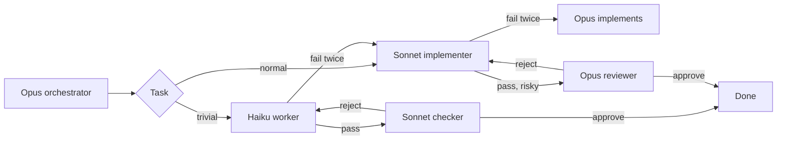

# 🎚️ cc-tiers

### Opus plans. Sonnet builds. Haiku does the small stuff.

A Claude Code plugin that keeps each task on the cheapest tier that can finish it, then escalates with the failure notes attached.

[](https://claude.com/claude-code)
[](#-install)
[](LICENSE)

**English** · [Português](README.pt-BR.md)

⚡ Haiku, Sonnet, and Opus  •  🔁 two failures, then escalate  •  💸 cc-cost when it is installed

---

## 🚀 Install

At the prompt of a Claude Code session, once this repo is the marketplace `edsoncantuaria/cc-tiers`:

```
/plugin install cc-tiers --marketplace edsoncantuaria/cc-tiers
```

> [!TIP]
> Answer `y` to add the marketplace, then pick a scope. The next session starts on the Opus orchestrator — nothing else to install.

To try a local checkout without publishing:

```bash
git clone https://github.com/edsoncantuaria/cc-tiers
claude --plugin-dir /path/to/cc-tiers
```

---

## 🔎 Who does what

| Tier | Agent | Model | Does |
| :-: | --- | --- | --- |
| Plan | `cc-tiers:orchestrator` | Opus | Splits the request, delegates, and implements only the ceiling |
| Default | `cc-tiers:implementer` | Sonnet | Features, bug fixes, tests, local refactors |
| Trivial | `cc-tiers:worker` | Haiku | Renames, typos, formatting, lookups, simple searches, ~15-line edits |
| Check | `cc-tiers:checker` | Sonnet | A fresh pass over Haiku's output. Does not edit |
| Review | `cc-tiers:reviewer` | Opus | A fresh pass over risky or non-trivial work. Does not edit |

While the plugin is enabled, `settings.json` sets the session agent to `orchestrator`. Your own `agent` in `~/.claude/settings.json` still wins. If you override it, `/cc-tiers:tiers` runs the same workflow.

The agents pin `model: haiku`, `sonnet`, or `opus`. The orchestrator does not pass a model on the call, because a per-call override would replace the tier.



---

## 🔁 Escalation

A failure is a failed test, a rejected review, or a subagent error. The task may fail **twice** at its tier (`max_attempts`, default 2). The next attempt moves up, and the failure notes go with it:

**Haiku → Sonnet → Opus**

The new tier starts at zero. Opus is the last stop: the orchestrator does that work itself, and if those attempts fail too it stops and tells you. A review rejection counts against the tier that wrote the diff, not against the checker or the reviewer. Budget routing does not block this ceiling.

A hook on the Agent tool keeps the counter. When it reports `cc-tiers counted a failure`, that count is the one the orchestrator follows.

---

## 💸 Spend, with cc-cost

When [cc-cost](https://github.com/edsoncantuaria/cc-cost) is installed, the session summary and each finished task report **fresh tokens per model tier**. Fresh tokens are input + cache write + output. Cache reads stay out, the same rule cc-cost uses. The hook attributes transcript usage, and the agent result's own usage, to the `CC_TIERS_TASK` slug.

The 5h and 7d windows use cc-cost's kinds, `five_hour` and `seven_day`. The hook reads them from the hook payload when Claude Code includes them, from the transcript, and from `limits.json` or `store.json` in cc-cost's plugin data directory (`~/.claude/plugins/data/cc-cost/`). A daily total is reported when that directory holds cc-cost's `novos:<day>:<sessionId>` keys.

If cc-cost is not installed, those lines are omitted. Routing, retries, and review keep working. A missing window reading does not invent a percent.

---

## 🧭 Budget

`budget_5h` and `budget_7d` default to 80. When either window is at or above its threshold, the session says `Budget routing: conserve`. New work stays on Haiku or Sonnet. Opus still plans, still takes a task that already used its attempts on Sonnet, and still reviews critical work.

A window whose reset time is already past counts as 0, the same way cc-cost draws it. No reading yet means the hook says routing does not conserve.

---

## 🧠 Learning from Haiku

With `learn` set to `on` (the default), a Haiku failure is appended to `.claude/cc-tiers-history.json` in the project. The next task that shares that kind, or enough of its words, starts on Sonnet instead of Haiku. `off` writes nothing and ignores the file.

The first write adds `.claude/cc-tiers-history.json` to the project's `.gitignore` when the project is a git checkout or already has a `.gitignore`. The plugin repo ignores that path too.

---

## 💬 Commands

| Command | What it does |
| --- | --- |
| `/cc-tiers:tiers [task]` | Plan, route, and run the work |
| `/cc-tiers:route [task]` | Name the tier and stop. No edits |
| `/cc-tiers:escalate [slug]` | Move that task up one tier now, notes included |

You can also ask in plain language. The `tiers` skill loads for an implement, fix, rename, or review request. Mention an agent directly with `@agent-cc-tiers:worker`, `@agent-cc-tiers:implementer`, `@agent-cc-tiers:checker`, or `@agent-cc-tiers:reviewer`.

---

## 🎬 Example

You: "Rename `fetchUser` to `loadUser` in `api.ts`, and add pagination to `GET /users`."

1. The Opus orchestrator splits it into `rename-fetch-user` (Haiku) and `users-pagination` (Sonnet).
2. Haiku renames the symbol and the check passes. The policy is `cheap`, so `cc-tiers:checker` on Sonnet reads the one-file rename and approves it. Opus is not asked.
3. Sonnet adds pagination. The cursor test fails. That is failure 1, so Sonnet retries with the traceback in the prompt. The tests pass. Ordinary Sonnet work is not sent to Opus.
4. The route is a public API, so the Opus reviewer reads the diff and rejects it: the cursor is not validated. That is failure 2 on Sonnet.
5. The limit is 2, so the task escalates to Opus with both notes — the traceback and the review. Opus fixes the validation. The reviewer approves on the next pass.
6. The orchestrator reports both slugs, the tier that finished each one, who reviewed them, and that pagination escalated. When cc-cost is installed, each slug also carries its fresh-token line.

A later "add pagination for users" in this repo starts on Sonnet, because Haiku already failed at that kind and `learn` is on.

---

## ⚙️ Configure

Open `/config` and set the cc-tiers rows. They apply on the next session (the SessionStart hook reads them).

| Key | Default | Meaning |
| --- | --- | --- |
| `max_attempts` | `2` | Failures allowed at one tier before escalating. 1–5 |
| `review_policy` | `cheap` | `cheap`, `risky`, `always`, or `never` |
| `learn` | `on` | Record Haiku failures and start similar tasks on Sonnet. `off` disables it |
| `budget_5h` | `80` | Percent of the `five_hour` window that starts conserving. 1–100 |
| `budget_7d` | `80` | Percent of the `seven_day` window that starts conserving. 1–100 |
| `trivial_extra` | empty | Comma-separated phrases added to the Haiku list |
| `risky_extra` | empty | Comma-separated phrases added to the Opus review list |

`cheap` sends Haiku output to the Sonnet checker and sends Opus review only for a review phrase or the ceiling. `risky` is the 0.1.0 behavior: Opus reviews non-trivial work and skips a trivial Haiku pass. `always` reviews every pass (Haiku on Sonnet, the rest on Opus). `never` skips review. While a budget window is conserving, Opus review is reserved for critical work even under `risky` or `always`.

To replace a whole phrase list, add `.claude/cc-tiers.json` to the project. A list you include replaces that list; lists you omit stay at the default. The same file may set `learn`, `budget5h`, and `budget7d` when `/config` leaves them empty. `/config` still wins when both are set. See `config/cc-tiers.example.json`.

```json
{
  "learn": "on",
  "budget5h": 80,
  "budget7d": 80,
  "trivialExtra": ["changelog edits"],
  "tiers": {
    "haiku": { "when": ["rename a symbol in one or two files", "changelog edits"] }
  }
}
```

The escalation order is fixed. Routing phrases, the retry limit, the review policy, learning, and the two budget thresholds are the knobs.

---

## 📋 Requirements

- Claude Code **2.1.271+** (the `/config` pickers use `userConfig.options`).
- Node.js on `PATH` as `node`, which Claude Code already ships. The hooks do not call Python.

## 🛠️ Development

```bash
git clone https://github.com/edsoncantuaria/cc-tiers
cd cc-tiers
node --test tests/*.test.mjs
claude plugin validate --strict .
claude --plugin-dir .
```

> [!WARNING]
> Copying the folder into a project does not load it. Use the marketplace install or `--plugin-dir`. Don't enable both at once or the agents show up twice.

### Layout

| Path | Owns |
| --- | --- |
| `.claude-plugin/plugin.json` | Name, metadata, and the `/config` knobs |
| `.claude-plugin/marketplace.json` | Marketplace entry, source `./` |
| `settings.json` | Session agent: `orchestrator` |
| `agents/*.md` | Opus orchestrator and reviewer, Sonnet implementer and checker, Haiku worker |
| `skills/tiers/SKILL.md` | `/cc-tiers:tiers` |
| `commands/route.md` | `/cc-tiers:route` |
| `commands/escalate.md` | `/cc-tiers:escalate` |
| `config/routing.default.json` | Built-in phrase lists and default thresholds |
| `hooks/hooks.json` | SessionStart summary, and the Agent attempt counter |
| `hooks/cc_tiers.mjs` | Merge rules, the counter, spend, budget, and history |
| `CHANGELOG.md` | Release notes |

## 🔒 Privacy

No network and no telemetry. The hooks read the routing files, the plugin options Claude Code already passes in, the session transcript, and cc-cost's local plugin data when that plugin is installed. They write the attempt counter under the plugin data directory (`latest.json` and one file per session) and, when learning is on, `.claude/cc-tiers-history.json` in the project. Uninstalling the plugin removes the plugin data directory unless you pass `--keep-data`. The history file stays in the project until you delete it.

---

Made with ☕ by [@edsoncantuaria](https://github.com/edsoncantuaria) · [MIT](LICENSE)

If it keeps Opus off the typo fixes, leave a ⭐
