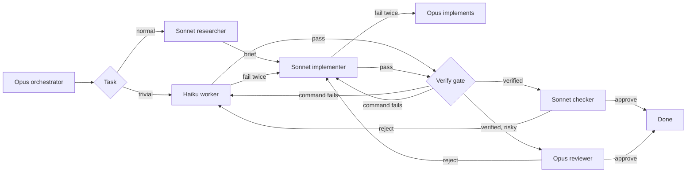

# 🎚️ cc-tiers

### Opus plans and reviews. Sonnet builds. Research comes first.

A Claude Code plugin for Pro and Max subscribers who want better answers, not cheaper ones. Plan, research, implementation, and review each run in their own context: Opus plans, Sonnet researches and then builds, and Opus reviews the result without having seen how it was written. When a task fails, the next tier gets the failure notes. The [benchmark](#-benchmark) measures quality with standard metrics; tokens are the price of that quality, not the goal.

[](https://claude.com/claude-code)
[](#-install)
[](LICENSE)

**English** · [Português](README.pt-BR.md)

🔬 research before code  •  🧐 independent review  •  🪜 more effort before a bigger model  •  🔁 two failures, then escalate  •  📏 quality measured

---

## 🚀 Install

At the prompt of a Claude Code session, once this repo is the marketplace `edsoncantuaria/cc-tiers`:

```
/plugin install cc-tiers --marketplace edsoncantuaria/cc-tiers
```

> [!TIP]
> Answer `y` to add the marketplace, then pick a scope. The next session starts on the Opus orchestrator — nothing else to install.

To try a local checkout without publishing:

```bash
git clone https://github.com/edsoncantuaria/cc-tiers
claude --plugin-dir /path/to/cc-tiers
```

---

## 🔎 Who does what

| Tier | Agent | Model | Does |
| :-: | --- | --- | --- |
| Plan | `cc-tiers:orchestrator` | Opus | Splits the request, delegates, and implements only the ceiling |
| Research | `cc-tiers:researcher` | Sonnet | Finds the installed version, that version's docs, and existing usage before code is written. Does not edit |
| Default | `cc-tiers:implementer` | Sonnet | Features, bug fixes, tests, local refactors |
| Trivial | `cc-tiers:worker` | Haiku | Renames, typos, formatting, lookups, simple searches, ~15-line edits |
| Check | `cc-tiers:checker` | Sonnet | A fresh pass over Haiku's output. Does not edit |
| Review | `cc-tiers:reviewer` | Opus | A fresh pass over risky or non-trivial work. Does not edit |
| Light mode | `cc-tiers:dispatcher` | Sonnet | Optional session agent for when the window is tight: it routes on Sonnet and calls Opus only when needed |
| Light plan | `cc-tiers:planner` | Opus | Plans a multi-task request for the dispatcher. Does not edit |
| Light ceiling | `cc-tiers:architect` | Opus | Implements the ceiling for the dispatcher |

While the plugin is enabled, `settings.json` sets the session agent to `orchestrator`. Your own `agent` in `~/.claude/settings.json` still wins. If you override it, `/cc-tiers:tiers` runs the same workflow.

The agents pin `model: haiku`, `sonnet`, or `opus`. The orchestrator does not pass a model on the call, because a per-call override would replace the tier. A PreToolUse hook refuses a cc-tiers delegation that tries.



---

## 🔬 Research first

Code written from memory of an old API version fails in ways a test does not always catch. Before a task goes to `cc-tiers:implementer` or `cc-tiers:architect`, `cc-tiers:researcher` (Sonnet, read-only) checks four things:

- The version in use, read from the lock file first and the manifest second.
- The docs of that version, from `vendor/` or `node_modules/` when installed, never the docs of the latest release by default.
- How the repo already calls the API, as `file:line`.
- Prior art outside the repo, only when it applies.

It returns a brief of under about 30 lines in three blocks, **Version and docs**, **In the repo**, and **Outside the repo**, with a source for every fact. The orchestrator pastes the whole report, trailer included, into the writer's prompt between two lines that hold only `CC_TIERS_RESEARCH_BEGIN` and `CC_TIERS_RESEARCH_END`, and adds `CC_TIERS_RESEARCH: done`. A task that touches no library, framework, or external API says why instead: `CC_TIERS_RESEARCH: none - <reason>`. One brief can serve several tasks: the researcher's prompt carries `CC_TIERS_COVERS: <slug>, <slug>`, and a pass marks all of them.

The PreToolUse hook enforces this. It refuses a call to the implementer or the architect that has neither a finished research for that task nor a `none` line. A research is not an attempt, and a failed research does not count against the task. The worker is exempt. The Opus ceiling and the dispatcher's own task are researched by prompt, with no hook check. `research: off` removes the step and the check.

---

## 📝 Specify and ask

Research says what is true; the criteria say what done means. Before a task that writes code goes to `cc-tiers:implementer` or `cc-tiers:architect`, the orchestrator (or the dispatcher) writes the acceptance criteria itself, from the request and the research, so you do not have to. The flow is research, specify, ask (only if needed), implement, review.

The criteria ride in the delegation prompt between two lines that hold only `CC_TIERS_SPEC_BEGIN` and `CC_TIERS_SPEC_END`, in under about 15 lines:

- `Criteria:` observable results.
- `Edge cases:` inputs or states that could break it.
- `Assumed:` (only when needed) what was chosen where the request was silent.

Every line says where it came from: `(request)`, `(repo: file:line)`, `(docs: <link or path>)`, `(decided: <why>)`, or `(user)` for an answer. The same block goes to the implementer and to the reviewer or checker of that task. The implementer builds and tests each line, and the reviewer rejects a criterion or edge case that is not met or not tested. A retry or an escalation reuses the block.

**When it asks.** Only when two reasonable readings lead to different code and neither the project nor the docs of the version in use decide. Everything else it decides and marks `(decided: ...)`. It asks once, before implementing, all questions together, at most 3, with `AskUserQuestion` as multiple choice and the recommended option first, with its reason. Your answer goes into the block as `(user)`.

**When nobody can answer.** If `AskUserQuestion` is unavailable or denied, it takes the recommended option, lists it under `Assumed:`, says so in the final report, and does not wait.

A task that needs no criteria (a mechanical edit, a lookup) says why with `CC_TIERS_SPEC: none - <reason>`. The light path and the worker skip this step. The PreToolUse hook refuses a call to the implementer or the architect that has neither a block with content nor a `none` line, and it ignores a `CC_TIERS_*` line inside the block. `specify: off` removes the step and the check.

---

## ✅ Verify

A `pass` used to be the agent's word. With the gate, the hook runs the check itself. Every report from a writer (worker, implementer, architect, the Opus ceiling, the dispatcher's own task) lists the commands that prove the work, one per line, before the status:

```
CC_TIERS_VERIFY: node --test test/booking.test.mjs
CC_TIERS_VERIFY: npx tsc --noEmit
CC_TIERS_STATUS: pass
```

When nothing can verify the change (a device write, a screen checked by hand), the report says so: `CC_TIERS_VERIFY: none - <reason>`. The command is the one focused on the area touched, the same one the writer ran, not the whole project.

**What the hook runs.** Only when the report is `pass`. It runs each command as argv, without a shell, in the project directory. A line with any of `` ; | & > < ` $ ( ) `` or a line break is refused. Two forms are read by the hook itself: `KEY=value` at the start becomes an environment variable (`APP_ENV=testing vendor/bin/phpunit`; `PATH`, `LD_*`, and `DYLD_*` are refused), and `cd <dir> && <command>` runs in `<dir>`, which must be relative and inside the project. The allow list is checked on what is left.

**Allow list.** `verify_allow` is a comma-separated list of prefixes, compared on whole words: `npm test` matches `npm test -- x`, not `npm testx`. The default covers `npm test`, `node --test`, `npx tsc`, `npx eslint`, `npx vitest`, `npx jest`, `npx playwright test`, PHPUnit, PHPStan, PHPCS, `pytest`, `go test`, and `cargo test`. `docker exec` is off by default, because with it any command runs inside the container. If you use it, for example on a PHP project in Docker, add `docker exec` in `/config`. The list limits the shape of the command, not what a test executes: a test is repository code, and the agent can already write code.

**Outcomes.**

- A command that exits non-zero runs once more. Passing the second time is a pass, reported as `flaky`. Failing twice is a failure, and the note for the next attempt carries the command, the exit code, and the last 40 lines of output.
- A command that hits `verify_timeout` (default 300 s) counts as a failure: a test that hangs is a defect or a broken environment, and either way the pass is not valid.
- `verify_budget` (default 600 s) caps the whole report, retries included. Commands past it do not run and are listed as not validated. That is not a failure, so a slow suite does not push the task up to Opus.
- A failure stops the commands after it.
- A command outside the list, a `none` line, or a refused line is **not validated**: nothing runs and it is not a failure. The message says which prefix to add in `/config`.
- A `pass` with no `CC_TIERS_VERIFY` line counts as a failure.

The final report says, per task, `verified: <commands>`, `flaky: <command>`, or `not validated: <reason>`, and `/cc-tiers:report` has a Verify column for it. The gate runs where the report is counted. For the Opus ceiling and the dispatcher there is no Agent call, so the pass waits until the Stop hook, which runs the commands outside the session lock. A rejected one blocks Stop once with the note. The light path (a trivial task done inline) is outside the gate. `verify: off` removes it.

**Limits.** The gate proves that the declared command passes, not that it covers the change: a writer can declare a test that does not touch what changed, and the review is what catches that. Parallel sessions that share a checkout can fail a command because of another task; the failure message says so when another task is active. Commands run through the hook, not through your permission rules, which is why the allow list exists.

---

## 🧾 Evidence-based review

A review used to reject with "a concrete reason", and that weighed the same with a proof or without one. Now a rejection counts only when it carries a blocking defect with a way to reproduce it. The reviewer receives the diff, the spec block, the research block, and the request, and never the writer's report or explanation: a reviewer that reads the writer's reasoning inherits its blind spots.

The reviewer goes through correctness, regression, security, state (order, idempotency, atomicity), and scope, in that order. Each finding is a block before the trailer:

```
CC_TIERS_FINDING_BEGIN
category: state
severity: blocking
evidence: command
command: node --test test/booking.test.mjs
expected: an old event does not close the reopened shift
observed: 'reopen keeps open' fails: expected open, got closed
where: src/booking.js:142
CC_TIERS_FINDING_END
```

`category` is `correctness`, `regression`, `security`, `state`, or `scope`. `severity` is `blocking` or `note`. A finding describes the defect, never the fix: the writer chooses the fix. Hardening the spec does not ask for, style, and anything that belongs to another issue are always notes.

**What counts.** `CC_TIERS_STATUS: fail` is a failure only with at least one valid blocking finding. `evidence` is one of three:

- `command`: a command in the `CC_TIERS_VERIFY` format, plus `expected`, `observed`, and `where`. The hook runs it once when it is on the allow list. If it **passes**, the finding is discarded as a false positive. If it fails, the finding stands. Off the list, it stands as `trace`.
- `trace`: a concrete input, `expected`, `observed`, and `where: file:line`. The hook does not check it.
- `coverage`: a criterion or edge case of the spec that no test exercises, with `criterion:` (the spec line, copied) and `where:` (the tests the reviewer read). It stands only when the criterion appears in that task's spec block, so it cannot become hardening the request did not ask for. A task with `CC_TIERS_SPEC: none` takes no `coverage` finding.

An incomplete block does not count. A `fail` with no valid blocking finding is not a failure: the message says `rejected without evidence; <n> finding(s) became notes` and the task is treated as approved. Notes go to the final report as a list, and the note sent to the writer on a real failure carries only the blocking findings. The reviewer does not edit files; it may run read commands and tests that already exist, and it does not add tests to the repo.

`review_evidence: off` goes back to 0.6: any reviewer `fail` counts. Limit: the hook does not check `trace` evidence, so a made-up trace still counts.

---

## 🔁 Escalation

A failure is a failed test, a rejected review, or a subagent error. The task may fail **twice** at its tier (`max_attempts`, default 2). The next attempt moves up, and the failure notes go with it:

**Haiku → Sonnet → Opus**

The new tier starts at zero. Opus is the last stop: the orchestrator does that work itself, and if those attempts fail too it stops and tells you. A review rejection counts against the tier that wrote the diff, not against the checker or the reviewer. Budget routing does not block this ceiling.

A hook on the Agent tool keeps the counter. When it reports `cc-tiers counted a failure`, that count is the one the orchestrator follows.

The hooks enforce what the prompts ask for:

- **Before a delegation** (PreToolUse), a call to a cc-tiers agent is refused when it passes `model`, has no `CC_TIERS_TASK` header, or sends an escalated task back down a tier. Sending a task up early (`/cc-tiers:escalate`) moves the counter with the notes carried.
- **Research** (`research: on`, the default): a call to the implementer or the architect is refused when its task has neither a researcher pass nor a `CC_TIERS_RESEARCH: none - <reason>` line.
- **Specify** (`specify: on`, the default): a call to the implementer or the architect is refused when its prompt has no `CC_TIERS_SPEC_BEGIN` / `CC_TIERS_SPEC_END` block with content and no `CC_TIERS_SPEC: none - <reason>` line.
- **Verify** (`verify: on`, the default): a writer's `pass` counts only after the hook runs the `CC_TIERS_VERIFY` commands that are on the allow list. A `pass` without those lines, or with a command that fails, counts as a failure. The Opus ceiling and the dispatcher are verified at Stop.
- **Evidence** (`review_evidence: on`, the default): a reviewer or checker `fail` counts only with a valid blocking finding. The hook re-runs the finding's command and discards one that passes, and a `fail` with no finding becomes notes.
- **Background agents** are counted too. The launch records the agent id, and SubagentStop counts the report when it finishes. The note reaches the orchestrator on its next delegation, or at the end of the turn.
- **The Opus ceiling** has no Agent call, so the orchestrator marks its own attempt with a `CC_TIERS_TASK` / `CC_TIERS_TIER: opus` / `CC_TIERS_ROLE: orchestrator` header and closes it with `CC_TIERS_STATUS`. The hook counts that trailer like any other report.
- Parallel agents share one counter file per session, behind a lock, written atomically.
- **API and network errors** (overloaded, rate limit, 5xx) are not failures. The hook says so and the same tier runs again, so an outage does not push work up to Opus.

---

## 🪜 Effort

Each tier also has an effort ladder. A retry at the same tier runs one effort level higher before the task changes model, on the bet that more thinking on Sonnet can fix what would otherwise take a new model, and so the notes stay in one context:

| Tier | Attempt 1 | Attempt 2 | Attempt 3+ |
| --- | --- | --- | --- |
| Haiku | `low` | `medium` | `medium` |
| Sonnet | `high` | `xhigh` | `xhigh` |
| Opus (`cc-tiers:architect`) | `high` | `xhigh` | `xhigh` |

The PreToolUse hook sets `effort` on the Agent call (Claude Code's per-call `effort`, 2.1.292+), so the orchestrator cannot forget it. It may ask for a higher level, never a lower one, and never above the top of the ladder. A risky Sonnet task, one that matches a review keyword, starts at `xhigh`. While budget routing is conserving, effort stops at `high`. When the Opus orchestrator implements the ceiling itself, it keeps its own session effort. `CLAUDE_CODE_EFFORT_LEVEL`, when set, wins over all of this.

`effort_ladder: off` leaves each agent at the effort its file pins. A project can replace a ladder in `.claude/cc-tiers.json` with `effort.haiku`, `effort.sonnet`, `effort.opus`, and `effort.conserveCap`.

---

## 🧪 Classifier

The keyword lists are a first guess. Two checks stand behind them before a task reaches Haiku:

- **Complexity score**, local and free. Several steps (bullets, "and then", "e depois"), three or more files, design or investigation wording (refactor, architecture, debug, flaky, memory leak), or a long brief add points. At 2 points a trivial-looking task starts on Sonnet. `/cc-tiers:route` prints the score and its signals.
- **Large files.** When the task names files in the project that add up to 400 KB or more (`largeFileBytes`), it starts on Sonnet. This is cc-tiers' take on long-context routing: every current model has a 1M window, but a huge file is still a lot for one cheap pass, and Haiku 4.5, if your `haiku` alias still points there, has only 200K.
- **Haiku classifier**, a `prompt` hook that runs only on `cc-tiers:worker` calls. A quick Haiku pass reads the task, and when it is not really trivial the call is refused with the reason, and the orchestrator sends the same slug to Sonnet. That is a routing correction, not a failure. `classifier: local` turns it off: the orchestrator then marks worker prompts `CC_TIERS_CLASSIFY: skip`, which the command hook only accepts in that mode.

---

## 🪶 Light mode

Plan, research, and review in separate contexts use more of your window than one thread. Light mode is for when the window is tight. The Opus orchestrator reads every request, even a typo fix, and every subagent starts a fresh context, so for a small task that overhead can cost more than the task. Two things cut it:

- **Light path** (`light_path: inline`, the default). When a request is one trivial task, the UserPromptSubmit hook tells the session agent to do it itself: no plan, no worker, no checker. `delegate` sends it to the worker in one call instead (the 0.4 behavior), and `off` plans every request.
- **Light mode**, the `cc-tiers:dispatcher` session agent on Sonnet. It does one ordinary task itself, marking the attempt with a `CC_TIERS_ROLE: dispatcher` trailer that the hooks count, so two failures still move it to Opus. It calls Opus only for three things: `cc-tiers:planner` for a request with more than one task or a design decision, `cc-tiers:architect` for a task that used its attempts on Sonnet, and `cc-tiers:reviewer` for risky work.

Turn on light mode for one session with `claude --agent cc-tiers:dispatcher`, or for good with `"agent": "cc-tiers:dispatcher"` in `~/.claude/settings.json`. The planner starts in a fresh context, so for a long conversation that keeps building on earlier turns, the orchestrator is the better fit.

---

## 💸 Spend and cost

This is optional. Quality is the point of cc-tiers; this section only tells you what it spent. When [cc-cost](https://github.com/edsoncantuaria/cc-cost) is installed, the session summary and each finished task report **fresh tokens per model tier**. Fresh tokens are input + cache write + output. Cache reads stay out, the same rule cc-cost uses. A subagent's tokens come from the Agent result, or from its own transcript when it ran in the background, and go to its `CC_TIERS_TASK` slug. The orchestrator's message that delegates a task counts toward that task, and so do its turns inside a ceiling attempt. Its other turns are listed as `(orchestration)`. The hook reads the session transcript incrementally, from where the last hook stopped, so totals only grow and long sessions stay cheap.

The 5h and 7d windows use cc-cost's kinds, `five_hour` and `seven_day`. The hook reads them from the hook payload when Claude Code includes them, from the transcript as it is scanned, and from `limits.json` or `store.json` in cc-cost's plugin data directory (`~/.claude/plugins/data/cc-cost/`). A daily total is reported when that directory holds cc-cost's `novos:<day>:<sessionId>` keys.

If cc-cost is not installed, those lines are omitted. Routing, retries, and review keep working. A missing window reading does not invent a percent.

Cost needs no other plugin. Each finished task gets a `cc-tiers cost` line, an estimate at Anthropic API list prices from the price table in `config/routing.default.json`. It prices each model by its own id (Opus 5.5 at $4/$20 per million, Sonnet 5.5 at $2/$10, Haiku 5.5 at $0.10/$0.50, older models at theirs), with cache reads at the model's rate and cache writes at 1.25x input, or 2x for the 1-hour cache. Next to it is the same tokens at Opus rates, for comparison. A subscription is not billed this way. `show_cost` is `off` by default; set it to `on` for these lines. `/cc-tiers:report` shows the whole session as a table: tiers, attempts, escalations, effort, review, status, and cost per task.

---

## 🧭 Budget

Budget routing protects your Pro/Max window. `budget_5h` and `budget_7d` default to 80. When either window is at or above its threshold, the session says `Budget routing: conserve`. New work stays on Haiku or Sonnet. Opus still plans, still takes a task that already used its attempts on Sonnet, and still reviews critical work.

A window whose reset time is already past counts as 0, the same way cc-cost draws it. No reading yet means the hook says routing does not conserve.

---

## 🧑‍🏫 With the advisor

Claude Code's [advisor tool](https://code.claude.com/docs/en/advisor) lets a model consult a stronger one at decision points, with the whole conversation in view. It is a session setting (`/advisor opus`), not something a plugin can switch on per agent, and subagents inherit it. That decides where it pays:

- **Light mode + Opus advisor** is the good pairing. The Sonnet dispatcher asks Opus at the hard moments without a fresh `cc-tiers:planner` context, and Sonnet and Haiku subagents can ask too. Expect fewer planner calls and escalations; each consultation reads the full transcript at Opus rates.
- **Orchestrator + Opus advisor** doubles Opus: an Opus main thread consulting another Opus. Leave the advisor off there unless the work is high-stakes.

The advisor's tokens count toward `/usage`. cc-tiers does not see them per task, so `/cc-tiers:report` leaves them out.

---

## 🧠 Learning from Haiku and Sonnet

With `learn` set to `on` (the default), a Haiku failure is appended to `.claude/cc-tiers-history.json` in the project. The next task with the same slug, or enough of the same words, starts on Sonnet instead of Haiku. A task that used its attempts on Sonnet is recorded too, and a similar task later starts on Sonnet at the top of its effort ladder (`xhigh`) instead of climbing it again. Opus still never starts a task. Words are compared without accents, so `migração` and `migracao` match. `off` writes nothing and ignores the file.

The first write adds the file to `.git/info/exclude` when the project is a git checkout (worktrees included), so it stays out of git without touching your tracked `.gitignore`. The plugin repo ignores that path too.

---

## 💬 Commands

| Command | What it does |
| --- | --- |
| `/cc-tiers:tiers [task]` | Plan, route, and run the work |
| `/cc-tiers:route [task]` | Name the tier and stop. Runs the same heuristic as the hooks. No edits |
| `/cc-tiers:escalate [slug]` | Move that task up one tier now, notes included |
| `/cc-tiers:report [--all]` | Per-task table for this session: tiers, attempts, effort, review, verify, status, and cost next to Opus rates. The Verify column says `ok`, `flaky`, or `not validated` |

You can also ask in plain language. The `tiers` skill loads for an implement, fix, rename, or review request. Mention an agent directly with `@agent-cc-tiers:worker`, `@agent-cc-tiers:implementer`, `@agent-cc-tiers:checker`, or `@agent-cc-tiers:reviewer`.

---

## 🎬 Example

You: "Rename `fetchUser` to `loadUser` in `api.ts`, and add pagination to `GET /users`."

1. The Opus orchestrator splits it into `rename-fetch-user` (Haiku) and `users-pagination` (Sonnet).
2. Haiku renames the symbol and the check passes. The policy is `risky`, and a one-file rename is not risky, so there is no review pass for it.
3. `users-pagination` is a normal task, so the researcher runs first. It reads the lock, finds the framework version in use, opens that version's docs in `node_modules/`, and cites how `GET /orders` already paginates. The brief goes into the Sonnet prompt.
4. Sonnet adds pagination at effort `high`. The cursor test fails. That is failure 1, so Sonnet retries at `xhigh` with the traceback in the prompt. The tests pass.
5. The route is a public API, so the Opus reviewer reads the diff in a fresh context and rejects it: the cursor is not validated. That is failure 2 on Sonnet.
6. The limit is 2, so the task escalates to Opus with both notes, the traceback and the review. The orchestrator researches that attempt itself, fixes the validation, and the reviewer approves on the next pass.
7. The orchestrator reports both slugs, the tier that finished each one, who reviewed them, and that pagination escalated. With `show_cost` on, each slug also carries its cost line.

A later "add pagination for users" in this repo starts on Sonnet, because Haiku already failed at that kind and `learn` is on.

---

## ⚙️ Configure

Open `/config` and set the cc-tiers rows. They apply on the next session (the SessionStart hook reads them).

| Key | Default | Meaning |
| --- | --- | --- |
| `max_attempts` | `2` | Failures allowed at one tier before escalating. 1–5 |
| `review_policy` | `risky` | `risky`, `cheap`, `always`, or `never` |
| `learn` | `on` | Record Haiku failures and start similar tasks on Sonnet. `off` disables it |
| `budget_5h` | `80` | Percent of the `five_hour` window that starts conserving. 1–100 |
| `budget_7d` | `80` | Percent of the `seven_day` window that starts conserving. 1–100 |
| `trivial_extra` | empty | Comma-separated phrases added to the Haiku list |
| `risky_extra` | empty | Comma-separated phrases added to the Opus review list |
| `effort_ladder` | `on` | Raise effort on a retry before changing model. `off` keeps each agent's own effort |
| `classifier` | `haiku` | `haiku` adds the Haiku check on worker calls. `local` uses only keywords and the complexity score |
| `light_path` | `inline` | One trivial task: `inline` does it in the session, `delegate` sends it to the worker, `off` plans it |
| `show_cost` | `off` | `on` shows the estimated cost of each task and the session next to Opus rates |
| `research` | `on` | Require a researcher brief, or a `none - <reason>` line, before code goes to the implementer or the architect. `off` removes the step |
| `specify` | `on` | Require acceptance criteria, or a `CC_TIERS_SPEC: none - <reason>` line, before code goes to the implementer or the architect, and let the orchestrator ask what changes the result. `off` removes the step |
| `verify` | `on` | A writer's `pass` must list the commands that prove it in `CC_TIERS_VERIFY` lines, and the hook runs the ones on the allow list. `off` takes a pass from the report alone |
| `verify_allow` | see below | Comma-separated command prefixes the gate may run, compared on whole words. `docker exec` is not in the default. Blank uses the default |
| `verify_timeout` | `300` | Seconds one gate command may run before it counts as a failure. 10–600 |
| `verify_budget` | `600` | Seconds the gate may spend on one report. Commands past it are not validated, not failed. 30–600 |
| `review_evidence` | `on` | A reviewer's `fail` counts only with a blocking finding that has evidence. `off` counts any `fail` |

The default `verify_allow` is `npm test, npm run test, node --test, npx tsc, npx eslint, npx vitest, npx jest, npx playwright test, vendor/bin/phpunit, ./vendor/bin/phpunit, vendor/bin/phpstan, ./vendor/bin/phpstan, vendor/bin/phpcs, ./vendor/bin/phpcs, pytest, python -m pytest, go test, cargo test`.

`risky` is the default: Opus reviews non-trivial work in a fresh context and skips a trivial Haiku pass. `cheap` sends Haiku output to the Sonnet checker and sends Opus review only for a review phrase or the ceiling. `always` reviews every pass (Haiku on Sonnet, the rest on Opus). `never` skips review. While a budget window is conserving, Opus review is reserved for critical work even under `risky` or `always`.

Routing matches two kinds of lists. **Phrases** (`when`, `reviewWhen`, and the `_extra` options) match when the whole phrase appears in the task. **Keywords** (`haiku.keywords`, `opus.reviewKeywords`) match at the start of a word, case- and accent-insensitive: `migra` finds "migration" and "migração", `authent` finds "authentication" but not "author". The built-in keywords cover renames, typos, formatting and lookups for Haiku, and auth, payments, migrations, schemas, public APIs, security, and concurrency for Opus review, in English and Portuguese. A task that looks trivial but hits a review keyword, or scores 2 on complexity (`sonnet.complexKeywords` is one of its signals), starts on Sonnet.

To replace a whole list, add `.claude/cc-tiers.json` to the project. A list you include replaces that list; lists you omit stay at the default. The same file may set `learn`, `budget5h`, and `budget7d` when `/config` leaves them empty. `/config` still wins when both are set. See `config/cc-tiers.example.json`.

```json
{
  "learn": "on",
  "budget5h": 80,
  "budget7d": 80,
  "trivialExtra": ["changelog edits"],
  "tiers": {
    "haiku": { "when": ["rename a symbol in one or two files", "changelog edits"] },
    "opus": { "reviewKeywords": ["authent", "payment", "migrat", "terraform"] }
  },
  "effort": { "sonnet": ["medium", "high", "max"], "conserveCap": "high" }
}
```

The escalation order is fixed. Routing phrases and keywords, the retry limit, the effort ladders, the review policy, the research gate, the specify gate, the verify gate and evidence-based review, the classifier, learning, and the two budget thresholds are the knobs.

---

## 📊 Benchmark

> [!IMPORTANT]
> **The benchmark measures quality only: whether the work comes out right the first time.** It does not measure cost. Tokens are shown in the last column, for information.

A run is right the first time when the user would not have to ask again. They would when it does not work, it broke something that worked, it recreated code the project already had, or it is inconsistent across runs. `bench/` grades each run with hidden checks and reports:

| Metric | Meaning | Where it comes from |
| --- | --- | --- |
| `pass@1` | Share of runs that resolve the task, averaged over tasks. `Δ pass@1 vs Opus only` is the difference from Opus only, in percentage points | pass@k, HumanEval (Chen et al., 2021) |
| FAIL_TO_PASS | The hidden check fails on the untouched fixture and must pass after the change | SWE-bench (Jimenez et al., 2024) |
| PASS_TO_PASS | Test files that passed before the change must still pass, each re-run in its before-form | SWE-bench (Jimenez et al., 2024) |
| `pass^k` | Share of tasks resolved in all `k` runs. It drops when a configuration is lucky, not reliable. Shown as `(k=N)` | pass^k, τ-bench (Yao et al., 2024) |
| Resolved | FAIL_TO_PASS passed and no PASS_TO_PASS file regressed | SWE-bench |
| Broke something | Runs whose hidden check passed but that broke a test that passed before | PASS_TO_PASS |
| Recreated existing code | Runs that failed a hidden-check test whose name starts with `reuse: `. `—` when no run was checked for it | cc-tiers |
| Tokens per resolved task | Fresh tokens (input + cache write + output) divided by resolved tasks. For information only | cc-tiers |

Tests the model wrote do not count toward resolved; the raw JSON keeps them as `ownTests`. A task may list `changesTests`, the original test files it changes on purpose; they are left out of PASS_TO_PASS. Below the per-task table, **Where it made a difference** lists the tasks where a configuration resolved a different share of runs than Opus only.

**Two suites.**

- `bench/tasks-login.json`, the main suite and the default: one natural request, `POST /login`, with no hints, on `bench/fixture-login/`, a small API. The project's own state hides what the request does not say: a silent version trap (the installed dotenv 8.6.0 cuts the multi-line `PRIVATE_KEY` in `.env` at its first line), an existing token signing helper, and existing behaviour that can break. The hidden check is in `bench/checks-login/` and the reference in `bench/solutions-login/`.
- `bench/tasks-hard.json`: twelve realistic bug reports and requests on `bench/fixture-hard/`, a 1,600-line Node service with shared state, time zones, and async booking. The hidden checks are in `bench/checks-hard/` and the references in `bench/solutions-hard/`.

`npm test` verifies both sides of every check: it fails on the fixture and passes with the reference.

**Run it.**

```bash
npm run bench -- --tasks-file bench/tasks-login.json --configs opus,sonnet,cc-tiers --repeat 2 --out bench/results/login.json
npm run bench -- --tasks-file bench/tasks-hard.json --tasks traversal,race --configs opus,sonnet,cc-tiers --repeat 3 --out bench/results/hard-pair.json
npm run bench -- --tasks-file bench/tasks-hard.json --tasks race,cancel,instances,traversal,date-filter,csv-escape,offboarding,recurring-pack --configs opus,cc-tiers --repeat 2 --out bench/results/verify-evidence.json
npm run bench:table -- bench/results/login.json
```

> [!WARNING]
> A run uses your real Claude Code login, so on Pro or Max it spends your usage window. `npm run bench:table -- <result files>` prints the tables from saved results.

The login suite is one-shot only: its task edits the server and the config, so `--session` is refused. The runner loads only project and local settings, so your own CLAUDE.md, agents, and plugins stay out of the measurement. It disables `AskUserQuestion` for every configuration, Opus only and Sonnet only included: a headless run denies it anyway and nobody would answer. cc-tiers's prompts tell it to take the recommended option and record it under `Assumed:` (`agents/orchestrator.md`, Specify). For cc-tiers the runner also reads, from the session transcript, the escalations the hooks announced and whether each task was routed as this README says. For cc-tiers, a quality layers table shows what the gate and the review did: passes blocked by the gate, flaky commands, tasks not validated, findings discarded, rejections without evidence, and review rounds per task. The command for the verify and evidence suite (the 8 non-trivial tasks of the hard suite, Opus only against cc-tiers) is the last one in the list above.

**Results**, as measured, one-shot. The results below are from 0.6, before the gate and evidence-based review.

Login (`bench/results/login.json`, k=2, cc-tiers at plugin commit `18a1222`):

| Configuration | pass@1 | Δ pass@1 vs Opus only | pass^k | Resolved | Broke something | Recreated existing code | Tokens per resolved task |
| --- | --: | --: | --: | --: | --: | --: | --: |
| Opus only | 50% | — | 0% (k=2) | 1/2 | 0 | — | 50.2k |
| Sonnet only | 50% | 0 pp | 0% (k=2) | 1/2 | 0 | — | 40.1k |
| cc-tiers (Opus orchestrator) 18a1222 | 100% | +50 pp | 100% (k=2) | 2/2 | 0 | — | 202.4k |

| Task | Opus only | Sonnet only | cc-tiers (Opus orchestrator) 18a1222 |
| --- | --: | --: | --: |
| `login` (hard) | 🟡 1/2 | 🟡 1/2 | ✅ 2/2 |

**Where it made a difference** (resolved runs per task vs Opus only)

| Task | Opus only | Sonnet only | cc-tiers (Opus orchestrator) 18a1222 |
| --- | --: | --: | --: |
| `login` | 1/2 | 1/2 | 2/2 |

| Configuration | hard: pass@1 | Escalations | Routed as documented |
| --- | --: | --: | --: |
| Opus only | 50% | — | — |
| Sonnet only | 50% | — | — |
| cc-tiers (Opus orchestrator) 18a1222 | 100% | 1 | 2/2 |

| Configuration | hard |
| --- | --- |
| cc-tiers (Opus orchestrator) 18a1222 | 2/2 (sonnet (+ Opus review)) |

- Plain Opus and plain Sonnet each failed one of their two runs the same way: `/login` answered 500, because dotenv 8.6.0 had cut the key. cc-tiers resolved both runs; in both, the researcher found the truncation in `node_modules/dotenv` before any code was written.
- `Recreated existing code` shows `—` because these runs predate the column; none of the six runs failed the reuse test.
- The sample is small. cc-tiers took about 4× the tokens per resolved task of plain Opus (202.4k vs 50.2k) and about 12× its wall time (646 s vs 54 s per run), partly because the review asked for hardening the request did not ask for.

Hard pair (`bench/results/hard-pair.json`, `traversal` and `race`, k=3, cc-tiers at plugin commit `ef57726`):

| Configuration | pass@1 | Δ pass@1 vs Opus only | pass^k | Resolved | Broke something | Recreated existing code | Tokens per resolved task |
| --- | --: | --: | --: | --: | --: | --: | --: |
| Opus only | 100% | — | 100% (k=3) | 6/6 | 0 | — | 32.7k |
| Sonnet only | 50% | −50 pp | 50% (k=3) | 3/6 | 0 | — | 38.5k |
| cc-tiers (Opus orchestrator) | 100% | 0 pp | 100% (k=3) | 6/6 | 0 | — | 166.5k |

| Task | Opus only | Sonnet only | cc-tiers (Opus orchestrator) |
| --- | --: | --: | --: |
| `race` (hard) | ✅ 3/3 | ✅ 3/3 | ✅ 3/3 |
| `traversal` (hard) | ✅ 3/3 | ❌ 0/3 | ✅ 3/3 |

**Where it made a difference** (resolved runs per task vs Opus only)

| Task | Opus only | Sonnet only | cc-tiers (Opus orchestrator) |
| --- | --: | --: | --: |
| `traversal` | 3/3 | 0/3 | 3/3 |

| Configuration | hard: pass@1 | Escalations | Routed as documented |
| --- | --: | --: | --: |
| Opus only | 100% | — | — |
| Sonnet only | 50% | — | — |
| cc-tiers (Opus orchestrator) | 100% | 1 | 6/6 |

| Configuration | hard |
| --- | --- |
| cc-tiers (Opus orchestrator) | 6/6 (sonnet (+ Opus review)) |

- Plain Opus and cc-tiers resolved every run; plain Sonnet failed `traversal` in all three. In cc-tiers the code is written by Sonnet, and the Opus reviewer rejected its first `traversal` fix in every run.

**What the data does not show:** cc-tiers beating plain Opus on tasks with the rules spelled out. On the hard pair, plain Opus resolved every run too.

**Gate and evidence-based review (0.7), hard suite, k=2:** results pending. A tie with plain Opus on quality is a possible result and will be reported as one.

---

## 📋 Requirements

- Claude Code **2.1.295+** (the `/config` pickers use `userConfig.options`, the PreToolUse hook sets `onFailure`, and the effort ladder uses the per-call `effort` from 2.1.292).
- Node.js 18+ on `PATH` as `node`. The hooks call `node` directly, so they run the same under bash, Git Bash, and PowerShell on Windows. They do not call Python.

## 🛠️ Development

```bash
git clone https://github.com/edsoncantuaria/cc-tiers
cd cc-tiers
npm test
claude plugin validate --strict .
claude --plugin-dir .
```

> [!WARNING]
> Copying the folder into a project does not load it. Use the marketplace install or `--plugin-dir`. Don't enable both at once or the agents show up twice.

### Layout

| Path | Owns |
| --- | --- |
| `.claude-plugin/plugin.json` | Name, metadata, and the `/config` knobs |
| `.claude-plugin/marketplace.json` | Marketplace entry, source `./` |
| `settings.json` | Session agent: `orchestrator` |
| `agents/*.md` | Opus orchestrator, reviewer, planner, and architect, Sonnet researcher, implementer, checker, and dispatcher, Haiku worker |
| `skills/tiers/SKILL.md` | `/cc-tiers:tiers` |
| `commands/route.md` | `/cc-tiers:route` |
| `commands/escalate.md` | `/cc-tiers:escalate` |
| `config/routing.default.json` | Built-in phrase lists, effort ladders, and default thresholds |
| `hooks/hooks.json` | SessionStart summary, the Agent checks, effort, Haiku classifier, and counter, SubagentStop, Stop, and UserPromptSubmit |
| `hooks/cc_tiers.mjs` | Merge rules, the counter, spend, budget, and history |
| `hooks/route.mjs` | The heuristic behind `/cc-tiers:route` |
| `hooks/verify.mjs` | The verify gate: read `CC_TIERS_VERIFY`, the allow list, run the commands, and judge findings |
| `hooks/report.mjs` | The table behind `/cc-tiers:report` |
| `commands/report.md` | `/cc-tiers:report` |
| `bench/` | The benchmark: the login and hard suites (tasks, fixtures, hidden checks, references), the runner, and measured results |
| `.github/workflows/ci.yml` | Tests on Linux, macOS, and Windows, and `claude plugin validate` |
| `CHANGELOG.md` | Release notes |

## 🔒 Privacy

No telemetry, and the command hooks make no network calls. With `classifier: haiku`, the classifier hook sends each `cc-tiers:worker` call's input to Haiku through Claude Code, the same way the session reaches Claude. The hooks read the routing files, the plugin options Claude Code already passes in, the session transcript, and cc-cost's local plugin data when that plugin is installed. They write the attempt counter under the plugin data directory (`latest.json` and one file per session) and, when learning is on, `.claude/cc-tiers-history.json` in the project plus one line in `.git/info/exclude`. Uninstalling the plugin removes the plugin data directory unless you pass `--keep-data`. The history file stays in the project until you delete it.

---

Made with ☕ by [@edsoncantuaria](https://github.com/edsoncantuaria) · [MIT](LICENSE)

If it gets you better answers, leave a ⭐
