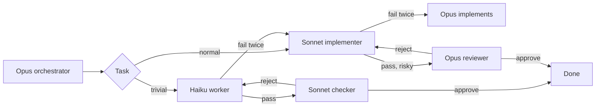

# 🎚️ cc-tiers

### Opus plans. Sonnet builds. Haiku does the small stuff.

A Claude Code plugin that keeps each task on the cheapest tier that can finish it, then escalates with the failure notes attached.

[](https://claude.com/claude-code)
[](#-install)
[](LICENSE)

**English** · [Português](README.pt-BR.md)

⚡ Haiku, Sonnet, and Opus  •  🪜 more effort before a bigger model  •  🔁 two failures, then escalate  •  💸 cc-cost when it is installed

---

## 🚀 Install

At the prompt of a Claude Code session, once this repo is the marketplace `edsoncantuaria/cc-tiers`:

```
/plugin install cc-tiers --marketplace edsoncantuaria/cc-tiers
```

> [!TIP]
> Answer `y` to add the marketplace, then pick a scope. The next session starts on the Opus orchestrator — nothing else to install.

To try a local checkout without publishing:

```bash
git clone https://github.com/edsoncantuaria/cc-tiers
claude --plugin-dir /path/to/cc-tiers
```

---

## 🔎 Who does what

| Tier | Agent | Model | Does |
| :-: | --- | --- | --- |
| Plan | `cc-tiers:orchestrator` | Opus | Splits the request, delegates, and implements only the ceiling |
| Default | `cc-tiers:implementer` | Sonnet | Features, bug fixes, tests, local refactors |
| Trivial | `cc-tiers:worker` | Haiku | Renames, typos, formatting, lookups, simple searches, ~15-line edits |
| Check | `cc-tiers:checker` | Sonnet | A fresh pass over Haiku's output. Does not edit |
| Review | `cc-tiers:reviewer` | Opus | A fresh pass over risky or non-trivial work. Does not edit |
| Light mode | `cc-tiers:dispatcher` | Sonnet | Optional session agent that routes on Sonnet and calls Opus only when needed |
| Light plan | `cc-tiers:planner` | Opus | Plans a multi-task request for the dispatcher. Does not edit |
| Light ceiling | `cc-tiers:architect` | Opus | Implements the ceiling for the dispatcher |

While the plugin is enabled, `settings.json` sets the session agent to `orchestrator`. Your own `agent` in `~/.claude/settings.json` still wins. If you override it, `/cc-tiers:tiers` runs the same workflow.

The agents pin `model: haiku`, `sonnet`, or `opus`. The orchestrator does not pass a model on the call, because a per-call override would replace the tier. A PreToolUse hook refuses a cc-tiers delegation that tries.



---

## 🔁 Escalation

A failure is a failed test, a rejected review, or a subagent error. The task may fail **twice** at its tier (`max_attempts`, default 2). The next attempt moves up, and the failure notes go with it:

**Haiku → Sonnet → Opus**

The new tier starts at zero. Opus is the last stop: the orchestrator does that work itself, and if those attempts fail too it stops and tells you. A review rejection counts against the tier that wrote the diff, not against the checker or the reviewer. Budget routing does not block this ceiling.

A hook on the Agent tool keeps the counter. When it reports `cc-tiers counted a failure`, that count is the one the orchestrator follows.

The hooks enforce what the prompts ask for:

- **Before a delegation** (PreToolUse), a call to a cc-tiers agent is refused when it passes `model`, has no `CC_TIERS_TASK` header, or sends an escalated task back down a tier. Sending a task up early (`/cc-tiers:escalate`) moves the counter with the notes carried.
- **Background agents** are counted too. The launch records the agent id, and SubagentStop counts the report when it finishes. The note reaches the orchestrator on its next delegation, or at the end of the turn.
- **The Opus ceiling** has no Agent call, so the orchestrator marks its own attempt with a `CC_TIERS_TASK` / `CC_TIERS_TIER: opus` / `CC_TIERS_ROLE: orchestrator` header and closes it with `CC_TIERS_STATUS`. The hook counts that trailer like any other report.
- Parallel agents share one counter file per session, behind a lock, written atomically.
- **API and network errors** (overloaded, rate limit, 5xx) are not failures. The hook says so and the same tier runs again, so an outage does not push work up to Opus.

---

## 🪜 Effort

Each tier also has an effort ladder. A retry at the same tier runs one effort level higher before the task changes model, because more thinking on Sonnet is cheaper than a jump to Opus:

| Tier | Attempt 1 | Attempt 2 | Attempt 3+ |
| --- | --- | --- | --- |
| Haiku | `low` | `medium` | `medium` |
| Sonnet | `medium` | `high` | `xhigh` |
| Opus (`cc-tiers:architect`) | `high` | `xhigh` | `xhigh` |

The PreToolUse hook sets `effort` on the Agent call (Claude Code's per-call `effort`, 2.1.292+), so the orchestrator cannot forget it. It may ask for a higher level, never a lower one, and never above the top of the ladder. A Sonnet task that matches a review keyword starts at `high`. While budget routing is conserving, effort stops at `high`. When the Opus orchestrator implements the ceiling itself, it keeps its own session effort. `CLAUDE_CODE_EFFORT_LEVEL`, when set, wins over all of this.

`effort_ladder: off` leaves each agent at the effort its file pins. A project can replace a ladder in `.claude/cc-tiers.json` with `effort.haiku`, `effort.sonnet`, `effort.opus`, and `effort.conserveCap`.

---

## 🧪 Classifier

The keyword lists are a first guess. Two checks stand behind them before a task reaches Haiku:

- **Complexity score**, local and free. Several steps (bullets, "and then", "e depois"), three or more files, design or investigation wording (refactor, architecture, debug, flaky, memory leak), or a long brief add points. At 2 points a trivial-looking task starts on Sonnet. `/cc-tiers:route` prints the score and its signals.
- **Large files.** When the task names files in the project that add up to 400 KB or more (`largeFileBytes`), it starts on Sonnet. This is cc-tiers' take on long-context routing: every current model has a 1M window, but a huge file is still a lot for one cheap pass, and Haiku 4.5, if your `haiku` alias still points there, has only 200K.
- **Haiku classifier**, a `prompt` hook that runs only on `cc-tiers:worker` calls. A quick Haiku pass reads the task, and when it is not really trivial the call is refused with the reason, and the orchestrator sends the same slug to Sonnet. That is a routing correction, not a failure. `classifier: local` turns it off: the orchestrator then marks worker prompts `CC_TIERS_CLASSIFY: skip`, which the command hook only accepts in that mode.

---

## 🪶 Light mode

The Opus orchestrator reads every request, even a typo fix, and every subagent starts a fresh context. The [benchmark](#-benchmark) showed that for a small task that overhead costs more than the task. Two things cut it:

- **Light path** (`light_path: inline`, the default). When a request is one trivial task, the UserPromptSubmit hook tells the session agent to do it itself: no plan, no worker, no checker. `delegate` sends it to the worker in one call instead (the 0.4 behavior), and `off` plans every request.
- **Light mode**, the `cc-tiers:dispatcher` session agent on Sonnet. It does one ordinary task itself, marking the attempt with a `CC_TIERS_ROLE: dispatcher` trailer that the hooks count, so two failures still move it to Opus. It calls Opus only for three things: `cc-tiers:planner` for a request with more than one task or a design decision, `cc-tiers:architect` for a task that used its attempts on Sonnet, and `cc-tiers:reviewer` for risky work.

Turn on light mode for one session with `claude --agent cc-tiers:dispatcher`, or for good with `"agent": "cc-tiers:dispatcher"` in `~/.claude/settings.json`. The planner starts in a fresh context, so for a long conversation that keeps building on earlier turns, the orchestrator is the better fit.

---

## 💸 Spend and cost

When [cc-cost](https://github.com/edsoncantuaria/cc-cost) is installed, the session summary and each finished task report **fresh tokens per model tier**. Fresh tokens are input + cache write + output. Cache reads stay out, the same rule cc-cost uses. A subagent's tokens come from the Agent result, or from its own transcript when it ran in the background, and go to its `CC_TIERS_TASK` slug. The orchestrator's message that delegates a task counts toward that task, and so do its turns inside a ceiling attempt. Its other turns are listed as `(orchestration)`. The hook reads the session transcript incrementally, from where the last hook stopped, so totals only grow and long sessions stay cheap.

The 5h and 7d windows use cc-cost's kinds, `five_hour` and `seven_day`. The hook reads them from the hook payload when Claude Code includes them, from the transcript as it is scanned, and from `limits.json` or `store.json` in cc-cost's plugin data directory (`~/.claude/plugins/data/cc-cost/`). A daily total is reported when that directory holds cc-cost's `novos:<day>:<sessionId>` keys.

If cc-cost is not installed, those lines are omitted. Routing, retries, and review keep working. A missing window reading does not invent a percent.

Cost needs no other plugin. Each finished task gets a `cc-tiers cost` line, an estimate at Anthropic API list prices from the price table in `config/routing.default.json`. It prices each model by its own id (Opus 5.5 at $4/$20 per million, Sonnet 5.5 at $2/$10, Haiku 5.5 at $0.10/$0.50, older models at theirs), with cache reads at the model's rate and cache writes at 1.25x input, or 2x for the 1-hour cache. Next to it is the same tokens at Opus rates, so you see what tiering saved. A subscription is not billed this way; read it as a comparison. `/cc-tiers:report` shows the whole session as a table: tiers, attempts, escalations, effort, review, status, and cost per task. `show_cost: off` hides the lines.

---

## 🧭 Budget

`budget_5h` and `budget_7d` default to 80. When either window is at or above its threshold, the session says `Budget routing: conserve`. New work stays on Haiku or Sonnet. Opus still plans, still takes a task that already used its attempts on Sonnet, and still reviews critical work.

A window whose reset time is already past counts as 0, the same way cc-cost draws it. No reading yet means the hook says routing does not conserve.

---

## 🧑‍🏫 With the advisor

Claude Code's [advisor tool](https://code.claude.com/docs/en/advisor) lets a model consult a stronger one at decision points, with the whole conversation in view. It is a session setting (`/advisor opus`), not something a plugin can switch on per agent, and subagents inherit it. That decides where it pays:

- **Light mode + Opus advisor** is the good pairing. The Sonnet dispatcher asks Opus at the hard moments without a fresh `cc-tiers:planner` context, and Sonnet and Haiku subagents can ask too. Expect fewer planner calls and escalations; each consultation reads the full transcript at Opus rates.
- **Orchestrator + Opus advisor** doubles Opus: an Opus main thread consulting another Opus. Leave the advisor off there unless the work is high-stakes.

The advisor's tokens count toward `/usage`. cc-tiers does not see them per task, so `/cc-tiers:report` leaves them out.

---

## 🧠 Learning from Haiku and Sonnet

With `learn` set to `on` (the default), a Haiku failure is appended to `.claude/cc-tiers-history.json` in the project. The next task with the same slug, or enough of the same words, starts on Sonnet instead of Haiku. A task that used its attempts on Sonnet is recorded too, and a similar task later starts on Sonnet at the top of its effort ladder (`xhigh`) instead of climbing it again. Opus still never starts a task. Words are compared without accents, so `migração` and `migracao` match. `off` writes nothing and ignores the file.

The first write adds the file to `.git/info/exclude` when the project is a git checkout (worktrees included), so it stays out of git without touching your tracked `.gitignore`. The plugin repo ignores that path too.

---

## 💬 Commands

| Command | What it does |
| --- | --- |
| `/cc-tiers:tiers [task]` | Plan, route, and run the work |
| `/cc-tiers:route [task]` | Name the tier and stop. Runs the same heuristic as the hooks. No edits |
| `/cc-tiers:escalate [slug]` | Move that task up one tier now, notes included |
| `/cc-tiers:report [--all]` | Per-task table for this session: tiers, attempts, effort, review, status, and cost next to Opus rates |

You can also ask in plain language. The `tiers` skill loads for an implement, fix, rename, or review request. Mention an agent directly with `@agent-cc-tiers:worker`, `@agent-cc-tiers:implementer`, `@agent-cc-tiers:checker`, or `@agent-cc-tiers:reviewer`.

---

## 🎬 Example

You: "Rename `fetchUser` to `loadUser` in `api.ts`, and add pagination to `GET /users`."

1. The Opus orchestrator splits it into `rename-fetch-user` (Haiku) and `users-pagination` (Sonnet).
2. Haiku renames the symbol and the check passes. The policy is `cheap`, so `cc-tiers:checker` on Sonnet reads the one-file rename and approves it. Opus is not asked.
3. Sonnet adds pagination at effort `medium`. The cursor test fails. That is failure 1, so Sonnet retries at `high` with the traceback in the prompt. The tests pass. Ordinary Sonnet work is not sent to Opus.
4. The route is a public API, so the Opus reviewer reads the diff and rejects it: the cursor is not validated. That is failure 2 on Sonnet.
5. The limit is 2, so the task escalates to Opus with both notes — the traceback and the review. Opus fixes the validation. The reviewer approves on the next pass.
6. The orchestrator reports both slugs, the tier that finished each one, who reviewed them, and that pagination escalated. When cc-cost is installed, each slug also carries its fresh-token line.

A later "add pagination for users" in this repo starts on Sonnet, because Haiku already failed at that kind and `learn` is on.

---

## ⚙️ Configure

Open `/config` and set the cc-tiers rows. They apply on the next session (the SessionStart hook reads them).

| Key | Default | Meaning |
| --- | --- | --- |
| `max_attempts` | `2` | Failures allowed at one tier before escalating. 1–5 |
| `review_policy` | `cheap` | `cheap`, `risky`, `always`, or `never` |
| `learn` | `on` | Record Haiku failures and start similar tasks on Sonnet. `off` disables it |
| `budget_5h` | `80` | Percent of the `five_hour` window that starts conserving. 1–100 |
| `budget_7d` | `80` | Percent of the `seven_day` window that starts conserving. 1–100 |
| `trivial_extra` | empty | Comma-separated phrases added to the Haiku list |
| `risky_extra` | empty | Comma-separated phrases added to the Opus review list |
| `effort_ladder` | `on` | Raise effort on a retry before changing model. `off` keeps each agent's own effort |
| `classifier` | `haiku` | `haiku` adds the Haiku check on worker calls. `local` uses only keywords and the complexity score |
| `light_path` | `inline` | One trivial task: `inline` does it in the session, `delegate` sends it to the worker, `off` plans it |
| `show_cost` | `on` | Show the estimated cost of each task and the session next to Opus rates. `off` hides it |

`cheap` sends Haiku output to the Sonnet checker and sends Opus review only for a review phrase or the ceiling. `risky` is the 0.1.0 behavior: Opus reviews non-trivial work and skips a trivial Haiku pass. `always` reviews every pass (Haiku on Sonnet, the rest on Opus). `never` skips review. While a budget window is conserving, Opus review is reserved for critical work even under `risky` or `always`.

Routing matches two kinds of lists. **Phrases** (`when`, `reviewWhen`, and the `_extra` options) match when the whole phrase appears in the task. **Keywords** (`haiku.keywords`, `opus.reviewKeywords`) match at the start of a word, case- and accent-insensitive: `migra` finds "migration" and "migração", `authent` finds "authentication" but not "author". The built-in keywords cover renames, typos, formatting and lookups for Haiku, and auth, payments, migrations, schemas, public APIs, security, and concurrency for Opus review, in English and Portuguese. A task that looks trivial but hits a review keyword, or scores 2 on complexity (`sonnet.complexKeywords` is one of its signals), starts on Sonnet.

To replace a whole list, add `.claude/cc-tiers.json` to the project. A list you include replaces that list; lists you omit stay at the default. The same file may set `learn`, `budget5h`, and `budget7d` when `/config` leaves them empty. `/config` still wins when both are set. See `config/cc-tiers.example.json`.

```json
{
  "learn": "on",
  "budget5h": 80,
  "budget7d": 80,
  "trivialExtra": ["changelog edits"],
  "tiers": {
    "haiku": { "when": ["rename a symbol in one or two files", "changelog edits"] },
    "opus": { "reviewKeywords": ["authent", "payment", "migrat", "terraform"] }
  },
  "effort": { "sonnet": ["medium", "high", "max"], "conserveCap": "high" }
}
```

The escalation order is fixed. Routing phrases and keywords, the retry limit, the effort ladders, the review policy, the classifier, learning, and the two budget thresholds are the knobs.

---

## 📊 Benchmark

`bench/` runs seven tasks (3 trivial, 2 normal, 1 mixed, 1 hard) on a small Node project, each graded by a hidden test. Measured on 2026-10-19 with Claude Code 2.1.303 and cc-tiers 0.5.0, two runs per task, at API list prices. Every configuration passed every task (112/112).

| Configuration | One task per session | All seven in one session | vs Opus only (session) |
| --- | --: | --: | --: |
| Opus only | $0.105 / task | $0.209 / task | — |
| Sonnet only | $0.050 / task | $0.096 / task | **−54%** |
| cc-tiers (Opus orchestrator) | $0.190 / task | $0.487 / task | **+133%** |
| cc-tiers light (Sonnet dispatcher) | $0.053 / task | $0.163 / task | **−22%** |

- **Light mode is the setting that saves:** about half the cost of Opus only on one-off tasks and 22% less in a working session, with Opus still on call for planning, escalation, and risky review.
- **The default Opus orchestrator costs more than plain Opus** on tasks this size: the Opus main thread pays for every request, and each subagent pays for a fresh context. It only pays back when much of the work is long enough to run on Sonnet or Haiku. For everyday work, use light mode (`claude --agent cc-tiers:dispatcher`).
- Plain Sonnet was cheapest and passed everything here; these tasks never needed an escalation. The value of tiers is the safety net on harder work, which this fixture does not stress.

Raw data: `bench/results/oneshot-all-0.5.json` and `bench/results/session-all-0.5.json`. Rerun with `npm run bench` (add `-- --session` for one session); it spends real tokens.

---

## 📋 Requirements

- Claude Code **2.1.295+** (the `/config` pickers use `userConfig.options`, the PreToolUse hook sets `onFailure`, and the effort ladder uses the per-call `effort` from 2.1.292).
- Node.js 18+ on `PATH` as `node`. The hooks call `node` directly, so they run the same under bash, Git Bash, and PowerShell on Windows. They do not call Python.

## 🛠️ Development

```bash
git clone https://github.com/edsoncantuaria/cc-tiers
cd cc-tiers
npm test
claude plugin validate --strict .
claude --plugin-dir .
```

> [!WARNING]
> Copying the folder into a project does not load it. Use the marketplace install or `--plugin-dir`. Don't enable both at once or the agents show up twice.

### Layout

| Path | Owns |
| --- | --- |
| `.claude-plugin/plugin.json` | Name, metadata, and the `/config` knobs |
| `.claude-plugin/marketplace.json` | Marketplace entry, source `./` |
| `settings.json` | Session agent: `orchestrator` |
| `agents/*.md` | Opus orchestrator, reviewer, planner, and architect, Sonnet implementer, checker, and dispatcher, Haiku worker |
| `skills/tiers/SKILL.md` | `/cc-tiers:tiers` |
| `commands/route.md` | `/cc-tiers:route` |
| `commands/escalate.md` | `/cc-tiers:escalate` |
| `config/routing.default.json` | Built-in phrase lists, effort ladders, and default thresholds |
| `hooks/hooks.json` | SessionStart summary, the Agent checks, effort, Haiku classifier, and counter, SubagentStop, Stop, and UserPromptSubmit |
| `hooks/cc_tiers.mjs` | Merge rules, the counter, spend, budget, and history |
| `hooks/route.mjs` | The heuristic behind `/cc-tiers:route` |
| `hooks/report.mjs` | The table behind `/cc-tiers:report` |
| `commands/report.md` | `/cc-tiers:report` |
| `bench/` | The benchmark: fixture project, tasks, hidden checks, runner, and results |
| `.github/workflows/ci.yml` | Tests on Linux, macOS, and Windows, and `claude plugin validate` |
| `CHANGELOG.md` | Release notes |

## 🔒 Privacy

No telemetry, and the command hooks make no network calls. With `classifier: haiku`, the classifier hook sends each `cc-tiers:worker` call's input to Haiku through Claude Code, the same way the session reaches Claude. The hooks read the routing files, the plugin options Claude Code already passes in, the session transcript, and cc-cost's local plugin data when that plugin is installed. They write the attempt counter under the plugin data directory (`latest.json` and one file per session) and, when learning is on, `.claude/cc-tiers-history.json` in the project plus one line in `.git/info/exclude`. Uninstalling the plugin removes the plugin data directory unless you pass `--keep-data`. The history file stays in the project until you delete it.

---

Made with ☕ by [@edsoncantuaria](https://github.com/edsoncantuaria) · [MIT](LICENSE)

If it keeps Opus off the typo fixes, leave a ⭐
