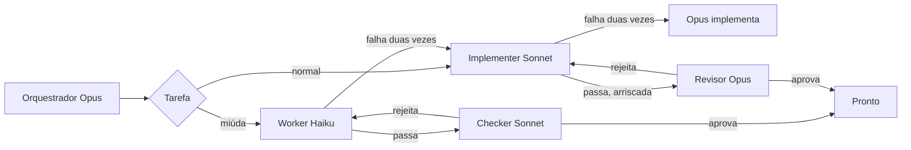

# 🎚️ cc-tiers

### O Opus planeja. O Sonnet constrói. O Haiku faz o miúdo.

Um plugin do Claude Code que deixa cada tarefa no nível mais barato que dá conta dela e sobe de nível com as notas da falha junto.

[](https://claude.com/claude-code)
[](#-instala%C3%A7%C3%A3o)
[](LICENSE)

[English](README.md) · **Português**

⚡ Haiku, Sonnet e Opus  •  🪜 mais effort antes de um modelo maior  •  🔁 duas falhas, depois sobe  •  💸 cc-cost quando ele está instalado

---

## 🚀 Instalação

No prompt de uma sessão do Claude Code, quando este repositório for o marketplace `edsoncantuaria/cc-tiers`:

```
/plugin install cc-tiers --marketplace edsoncantuaria/cc-tiers
```

> [!TIP]
> Responda `y` para adicionar o marketplace e escolha o escopo. A sessão seguinte começa no orquestrador Opus — nada mais para instalar.

Para experimentar um checkout local sem publicar:

```bash
git clone https://github.com/edsoncantuaria/cc-tiers
claude --plugin-dir /caminho/para/cc-tiers
```

---

## 🔎 Quem faz o quê

| Nível | Agente | Modelo | Faz |
| :-: | --- | --- | --- |
| Plano | `cc-tiers:orchestrator` | Opus | Divide o pedido, delega e só implementa o teto |
| Padrão | `cc-tiers:implementer` | Sonnet | Features, bugs, testes, refactors locais |
| Miúdo | `cc-tiers:worker` | Haiku | Renomear, typos, formatação, buscas simples, edições de ~15 linhas |
| Checagem | `cc-tiers:checker` | Sonnet | Uma passada nova sobre a saída do Haiku. Não edita |
| Revisão | `cc-tiers:reviewer` | Opus | Uma passada nova sobre trabalho arriscado ou não trivial. Não edita |
| Modo leve | `cc-tiers:dispatcher` | Sonnet | Agente de sessão opcional que encaminha no Sonnet e só chama o Opus quando precisa |
| Plano leve | `cc-tiers:planner` | Opus | Planeja um pedido com várias tarefas para o dispatcher. Não edita |
| Teto leve | `cc-tiers:architect` | Opus | Implementa o teto para o dispatcher |

Com o plugin ativo, o `settings.json` define o agente da sessão como `orchestrator`. O seu `agent` em `~/.claude/settings.json` continua valendo. Se você substituir, `/cc-tiers:tiers` roda o mesmo fluxo.

Os agentes fixam `model: haiku`, `sonnet` ou `opus`. O orquestrador não passa modelo na chamada, porque um override por chamada trocaria o nível. Um hook PreToolUse recusa a delegação do cc-tiers que tentar.



---

## 🔁 Escalonamento

Falha é teste que quebrou, revisão rejeitada ou erro do subagente. A tarefa pode falhar **duas vezes** no nível (`max_attempts`, padrão 2). A tentativa seguinte sobe, e as notas vão junto:

**Haiku → Sonnet → Opus**

O nível novo começa do zero. O Opus é o último degrau: o orquestrador faz esse trabalho e, se essas tentativas também falharem, ele para e te conta. Rejeição de revisão conta contra o nível que escreveu o diff, não contra o checker nem contra o revisor. O roteamento de orçamento não bloqueia esse teto.

Um hook na ferramenta Agent guarda o contador. Quando ele diz `cc-tiers counted a failure`, essa contagem é a que o orquestrador segue.

Os hooks garantem o que os prompts pedem:

- **Antes de uma delegação** (PreToolUse), a chamada a um agente do cc-tiers é recusada quando passa `model`, não tem o header `CC_TIERS_TASK` ou manda uma tarefa já escalada de volta para um nível abaixo. Subir uma tarefa antes do limite (`/cc-tiers:escalate`) move o contador junto, com as notas.
- **Agentes em background** também contam. O lançamento grava o id do agente, e o SubagentStop conta o relatório quando ele termina. O aviso chega ao orquestrador na próxima delegação ou no fim do turno.
- **O teto Opus** não tem chamada Agent, então o orquestrador marca a própria tentativa com o header `CC_TIERS_TASK` / `CC_TIERS_TIER: opus` / `CC_TIERS_ROLE: orchestrator` e fecha com `CC_TIERS_STATUS`. O hook conta esse trailer como qualquer outro relatório.
- Agentes em paralelo dividem um arquivo de contador por sessão, com lock e gravação atômica.
- **Erros de API e de rede** (sobrecarga, rate limit, 5xx) não são falhas. O hook avisa e o mesmo nível roda de novo, então uma instabilidade não empurra trabalho para o Opus.

---

## 🪜 Effort

Cada nível também tem uma escada de effort. Uma nova tentativa no mesmo nível roda um nível de effort acima antes de a tarefa trocar de modelo, porque pensar mais no Sonnet sai mais barato que pular para o Opus:

| Nível | Tentativa 1 | Tentativa 2 | Tentativa 3+ |
| --- | --- | --- | --- |
| Haiku | `low` | `medium` | `medium` |
| Sonnet | `medium` | `high` | `xhigh` |
| Opus (`cc-tiers:architect`) | `high` | `xhigh` | `xhigh` |

O hook PreToolUse define o `effort` na chamada Agent (o `effort` por chamada do Claude Code, 2.1.292+), então o orquestrador não tem como esquecer. Ele pode pedir um nível mais alto, nunca um mais baixo, e nunca acima do topo da escada. Uma tarefa do Sonnet que bate numa palavra-chave de revisão começa em `high`. Enquanto o orçamento está economizando, o effort para em `high`. Quando o orquestrador Opus implementa o teto ele mesmo, ele mantém o effort da própria sessão. `CLAUDE_CODE_EFFORT_LEVEL`, quando definido, ganha de tudo isso.

`effort_ladder: off` deixa cada agente no effort que o arquivo dele fixa. Um projeto pode trocar uma escada em `.claude/cc-tiers.json` com `effort.haiku`, `effort.sonnet`, `effort.opus` e `effort.conserveCap`.

---

## 🧪 Classificador

As listas de palavras-chave são um primeiro palpite. Duas checagens ficam atrás delas antes de uma tarefa chegar ao Haiku:

- **Pontuação de complexidade**, local e de graça. Vários passos (tópicos, "and then", "e depois"), três ou mais arquivos, palavras de design ou investigação (refatorar, arquitetura, depurar, flaky, vazamento de memória) ou um briefing longo somam pontos. Com 2 pontos, uma tarefa que parece miúda começa no Sonnet. O `/cc-tiers:route` mostra a pontuação e os sinais.
- **Arquivos grandes.** Quando a tarefa cita arquivos do projeto que somam 400 KB ou mais (`largeFileBytes`), ela começa no Sonnet. É a versão do cc-tiers para roteamento por contexto longo: todo modelo atual tem janela de 1M, mas um arquivo enorme ainda é muito para uma passada barata, e o Haiku 4.5, se o seu alias `haiku` ainda aponta para ele, tem só 200K.
- **Classificador Haiku**, um hook `prompt` que roda só nas chamadas a `cc-tiers:worker`. Uma passada rápida do Haiku lê a tarefa e, quando ela não é miúda de verdade, a chamada é recusada com o motivo, e o orquestrador manda o mesmo slug para o Sonnet. Isso é correção de rota, não falha. `classifier: local` desliga: o orquestrador passa a marcar os prompts do worker com `CC_TIERS_CLASSIFY: skip`, que o hook de comando só aceita nesse modo.

---

## 🪶 Modo leve

O orquestrador Opus lê todo pedido, até uma correção de typo, e todo subagente começa num contexto novo. O [benchmark](#-benchmark) mostrou que, numa tarefa pequena, esse custo fixo sai mais caro que a tarefa. Duas coisas cortam isso:

- **Caminho leve** (`light_path: inline`, o padrão). Quando um pedido é uma tarefa miúda só, o hook UserPromptSubmit diz ao agente da sessão para fazer ele mesmo: sem plano, sem worker, sem checker. `delegate` manda para o worker numa chamada (o comportamento da 0.4), e `off` planeja todo pedido.
- **Modo leve**, o agente de sessão `cc-tiers:dispatcher` no Sonnet. Ele faz sozinho uma tarefa comum, marcando a tentativa com um trailer `CC_TIERS_ROLE: dispatcher` que os hooks contam, então duas falhas ainda levam a tarefa para o Opus. Ele só chama o Opus para três coisas: `cc-tiers:planner` para um pedido com mais de uma tarefa ou uma decisão de design, `cc-tiers:architect` para uma tarefa que esgotou as tentativas no Sonnet, e `cc-tiers:reviewer` para trabalho arriscado.

Ligue o modo leve numa sessão com `claude --agent cc-tiers:dispatcher`, ou de vez com `"agent": "cc-tiers:dispatcher"` em `~/.claude/settings.json`. O planner começa num contexto novo, então para uma conversa longa que vai construindo em cima dos turnos anteriores, o orquestrador é a escolha melhor.

---

## 💸 Gasto e custo

Quando o [cc-cost](https://github.com/edsoncantuaria/cc-cost) está instalado, o resumo da sessão e cada tarefa terminada reportam **tokens novos por nível de modelo**. Tokens novos são entrada + escrita de cache + saída. Leituras de cache ficam de fora, a mesma regra do cc-cost. Os tokens de um subagente vêm do resultado do Agent, ou do próprio transcript dele quando rodou em background, e vão para o slug `CC_TIERS_TASK`. A mensagem do orquestrador que delega uma tarefa conta para essa tarefa, assim como os turnos dele dentro de uma tentativa no teto. Os outros turnos aparecem como `(orchestration)`. O hook lê o transcript da sessão de forma incremental, de onde o último hook parou, então os totais só crescem e sessões longas continuam baratas.

As janelas de 5h e 7d usam os tipos do cc-cost, `five_hour` e `seven_day`. O hook lê esses valores do payload do hook quando o Claude Code os inclui, do transcript à medida que é lido, e de `limits.json` ou `store.json` no diretório de dados do cc-cost (`~/.claude/plugins/data/cc-cost/`). O total do dia aparece quando esse diretório tem as chaves `novos:<dia>:<sessionId>` do cc-cost.

Se o cc-cost não está instalado, essas linhas somem. Roteamento, retentativas e revisão continuam. Uma janela sem leitura não inventa porcentagem.

O custo não precisa de outro plugin. Cada tarefa terminada ganha uma linha `cc-tiers cost`, uma estimativa a preço de lista da API da Anthropic tirada da tabela de preços em `config/routing.default.json`. Cada modelo é cobrado pelo próprio id (Opus 5.5 a $4/$20 por milhão, Sonnet 5.5 a $2/$10, Haiku 5.5 a $0,10/$0,50, modelos antigos aos preços deles), com leitura de cache no preço do modelo e escrita de cache a 1,25x a entrada, ou 2x no cache de 1 hora. Ao lado vem o custo dos mesmos tokens no preço do Opus, para você ver quanto a divisão em níveis economizou. Uma assinatura não é cobrada assim; leia como comparação. O `/cc-tiers:report` mostra a sessão inteira numa tabela: níveis, tentativas, escalonamentos, effort, revisão, status e custo por tarefa. `show_cost: off` esconde essas linhas.

---

## 🧭 Orçamento

`budget_5h` e `budget_7d` valem 80 por padrão. Quando uma das janelas chega no limiar, a sessão diz `Budget routing: conserve`. Trabalho novo fica no Haiku ou no Sonnet. O Opus ainda planeja, ainda pega a tarefa que já esgotou as tentativas no Sonnet, e ainda revisa o que é crítico.

Uma janela cujo horário de reset já passou conta como 0, do mesmo jeito que o cc-cost desenha. Sem leitura ainda, o hook diz que o roteamento não economiza.

---

## 🧑‍🏫 Com o advisor

O [advisor](https://code.claude.com/docs/en/advisor) do Claude Code deixa um modelo consultar outro mais forte nos momentos de decisão, vendo a conversa inteira. É uma configuração da sessão (`/advisor opus`), não algo que um plugin liga por agente, e os subagentes herdam. Isso decide onde ele compensa:

- **Modo leve + advisor Opus** é a combinação boa. O dispatcher Sonnet pergunta ao Opus nos momentos difíceis sem abrir um contexto novo do `cc-tiers:planner`, e os subagentes Sonnet e Haiku também podem perguntar. Espere menos chamadas ao planner e menos escalonamentos; cada consulta lê o transcript inteiro no preço do Opus.
- **Orquestrador + advisor Opus** dobra o Opus: uma thread principal Opus consultando outro Opus. Deixe o advisor desligado aí, a não ser que o trabalho seja crítico.

Os tokens do advisor entram no `/usage`. O cc-tiers não enxerga esses tokens por tarefa, então o `/cc-tiers:report` não os inclui.

---

## 🧠 Aprendendo com o Haiku e o Sonnet

Com `learn` em `on` (o padrão), uma falha do Haiku vai para `.claude/cc-tiers-history.json` no projeto. A tarefa seguinte com o mesmo slug, ou palavras suficientes em comum, começa no Sonnet em vez do Haiku. Uma tarefa que esgotou as tentativas no Sonnet também é gravada, e uma parecida depois começa no Sonnet já no topo da escada de effort (`xhigh`), em vez de subir tudo de novo. O Opus continua nunca começando uma tarefa. As palavras são comparadas sem acento, então `migração` e `migracao` casam. `off` não grava nada e ignora o arquivo.

A primeira gravação adiciona o arquivo ao `.git/info/exclude` quando o projeto é um checkout git (worktrees incluídas), então ele fica fora do git sem mexer no `.gitignore` versionado. O repositório do plugin também ignora esse caminho.

---

## 💬 Comandos

| Comando | O que faz |
| --- | --- |
| `/cc-tiers:tiers [tarefa]` | Planeja, encaminha e executa |
| `/cc-tiers:route [tarefa]` | Diz o nível e para. Usa a mesma heurística dos hooks. Sem editar |
| `/cc-tiers:escalate [slug]` | Sobe essa tarefa um nível agora, com as notas |
| `/cc-tiers:report [--all]` | Tabela por tarefa da sessão: níveis, tentativas, effort, revisão, status e custo ao lado do preço do Opus |

Dá também para pedir em linguagem comum. A skill `tiers` entra quando o pedido é implementar, corrigir, renomear ou revisar. Mencione um agente direto com `@agent-cc-tiers:worker`, `@agent-cc-tiers:implementer`, `@agent-cc-tiers:checker` ou `@agent-cc-tiers:reviewer`.

---

## 🎬 Exemplo

Você: "Renomeia `fetchUser` para `loadUser` em `api.ts` e adiciona paginação no `GET /users`."

1. O orquestrador Opus divide em `rename-fetch-user` (Haiku) e `users-pagination` (Sonnet).
2. O Haiku renomeia o símbolo e a checagem passa. A política é `cheap`, então o `cc-tiers:checker` no Sonnet lê o rename de um arquivo e aprova. O Opus não é chamado.
3. O Sonnet adiciona a paginação com effort `medium`. O teste do cursor falha. É a falha 1, então o Sonnet tenta de novo em `high` com o traceback no prompt. Os testes passam. Trabalho comum do Sonnet não vai para o Opus.
4. A rota é API pública, então o revisor Opus lê o diff e rejeita: o cursor não é validado. É a falha 2 no Sonnet.
5. O limite é 2, então a tarefa sobe para o Opus com as duas notas — o traceback e a revisão. O Opus corrige a validação. O revisor aprova na passada seguinte.
6. O orquestrador reporta os dois slugs, o nível que fechou cada um, quem revisou, e que a paginação escalou. Com o cc-cost instalado, cada slug também traz a linha de tokens novos.

Um "adiciona paginação para users" depois, neste repositório, começa no Sonnet, porque o Haiku já falhou nesse tipo e `learn` está `on`.

---

## ⚙️ Configuração

Abra `/config` e ajuste as linhas do cc-tiers. Valem na sessão seguinte (o hook de SessionStart lê esses valores).

| Chave | Padrão | Significado |
| --- | --- | --- |
| `max_attempts` | `2` | Falhas permitidas num nível antes de subir. 1–5 |
| `review_policy` | `cheap` | `cheap`, `risky`, `always` ou `never` |
| `learn` | `on` | Grava falhas do Haiku e manda tarefas parecidas para o Sonnet. `off` desliga |
| `budget_5h` | `80` | Porcentagem da janela `five_hour` que começa a economizar. 1–100 |
| `budget_7d` | `80` | Porcentagem da janela `seven_day` que começa a economizar. 1–100 |
| `trivial_extra` | vazio | Frases separadas por vírgula que entram na lista do Haiku |
| `risky_extra` | vazio | Frases separadas por vírgula que entram na revisão do Opus |
| `effort_ladder` | `on` | Sobe o effort numa nova tentativa antes de trocar de modelo. `off` mantém o effort de cada agente |
| `classifier` | `haiku` | `haiku` adiciona a checagem do Haiku nas chamadas ao worker. `local` usa só palavras-chave e a pontuação de complexidade |
| `light_path` | `inline` | Uma tarefa miúda: `inline` faz na sessão, `delegate` manda para o worker, `off` planeja |
| `show_cost` | `on` | Mostra o custo estimado de cada tarefa e da sessão ao lado do preço do Opus. `off` esconde |

`cheap` manda a saída do Haiku para o checker Sonnet e só manda revisão Opus para uma frase de revisão ou para o teto. `risky` é o comportamento da 0.1.0: o Opus revisa trabalho não trivial e pula um passe trivial do Haiku. `always` revisa todo passe (Haiku no Sonnet, o resto no Opus). `never` pula a revisão. Enquanto uma janela de orçamento está economizando, a revisão Opus fica para o trabalho crítico mesmo em `risky` ou `always`.

O roteamento usa dois tipos de lista. **Frases** (`when`, `reviewWhen` e as opções `_extra`) casam quando a frase inteira aparece na tarefa. **Palavras-chave** (`haiku.keywords`, `opus.reviewKeywords`) casam no começo de uma palavra, sem diferenciar maiúsculas nem acentos: `migra` acha "migration" e "migração", `authent` acha "authentication" mas não "author". As palavras-chave embutidas cobrem renomear, typos, formatação e buscas para o Haiku, e auth, pagamentos, migrações, schemas, APIs públicas, segurança e concorrência para a revisão Opus, em inglês e português. Uma tarefa que parece miúda mas bate numa palavra-chave de revisão, ou soma 2 de complexidade (`sonnet.complexKeywords` é um dos sinais), começa no Sonnet.

Para trocar uma lista inteira, crie `.claude/cc-tiers.json` no projeto. A lista que você incluir substitui aquela lista; as que você omitir ficam no padrão. O mesmo arquivo pode definir `learn`, `budget5h` e `budget7d` quando o `/config` deixa esses campos vazios. O `/config` continua ganhando quando os dois estão definidos. Veja `config/cc-tiers.example.json`.

```json
{
  "learn": "on",
  "budget5h": 80,
  "budget7d": 80,
  "trivialExtra": ["changelog edits"],
  "tiers": {
    "haiku": { "when": ["rename a symbol in one or two files", "changelog edits"] },
    "opus": { "reviewKeywords": ["authent", "payment", "migrat", "terraform"] }
  },
  "effort": { "sonnet": ["medium", "high", "max"], "conserveCap": "high" }
}
```

A ordem de escalonamento é fixa. As frases e palavras-chave de roteamento, o limite de tentativas, as escadas de effort, a política de revisão, o classificador, o aprendizado e os dois limiares de orçamento são os controles.

---

## 📋 Requisitos

- Claude Code **2.1.295+** (os seletores do `/config` usam `userConfig.options`, o hook PreToolUse usa `onFailure`, e a escada de effort usa o `effort` por chamada da 2.1.292).
- Node.js 18+ no `PATH` como `node`. Os hooks chamam `node` direto, então rodam igual no bash, no Git Bash e no PowerShell do Windows. Não chamam Python.

## 🛠️ Desenvolvimento

```bash
git clone https://github.com/edsoncantuaria/cc-tiers
cd cc-tiers
node --test tests/*.test.mjs
claude plugin validate --strict .
claude --plugin-dir .
```

> [!WARNING]
> Só copiar a pasta para um projeto não carrega o plugin. Use a instalação pelo marketplace ou `--plugin-dir`. Não deixe os dois ativos ao mesmo tempo, senão os agentes aparecem duplicados.

### Organização

| Caminho | Responsável por |
| --- | --- |
| `.claude-plugin/plugin.json` | Nome, metadados e os controles do `/config` |
| `.claude-plugin/marketplace.json` | Entrada do marketplace, source `./` |
| `settings.json` | Agente da sessão: `orchestrator` |
| `agents/*.md` | Orquestrador, revisor, planner e architect Opus, implementer, checker e dispatcher Sonnet, worker Haiku |
| `skills/tiers/SKILL.md` | `/cc-tiers:tiers` |
| `commands/route.md` | `/cc-tiers:route` |
| `commands/escalate.md` | `/cc-tiers:escalate` |
| `config/routing.default.json` | Listas de frases embutidas, escadas de effort e limiares padrão |
| `hooks/hooks.json` | Resumo no SessionStart, as checagens, o effort, o classificador Haiku e o contador do Agent, SubagentStop, Stop e UserPromptSubmit |
| `hooks/cc_tiers.mjs` | Regras de merge, o contador, gasto, orçamento e histórico |
| `hooks/route.mjs` | A heurística por trás do `/cc-tiers:route` |
| `hooks/report.mjs` | A tabela por trás do `/cc-tiers:report` |
| `commands/report.md` | `/cc-tiers:report` |
| `bench/` | O benchmark: projeto de teste, tarefas, checagens ocultas, executor e resultados |
| `.github/workflows/ci.yml` | Testes no Linux, macOS e Windows, e `claude plugin validate` |
| `CHANGELOG.md` | Notas da versão |

## 🔒 Privacidade

Sem telemetria, e os hooks de comando não fazem chamadas de rede. Com `classifier: haiku`, o hook classificador manda o input de cada chamada a `cc-tiers:worker` para o Haiku pelo Claude Code, do mesmo jeito que a sessão fala com o Claude. Os hooks leem os arquivos de roteamento, as opções de plugin que o Claude Code já passa, o transcript da sessão, e os dados locais do cc-cost quando esse plugin está instalado. Gravam o contador de tentativas no diretório de dados do plugin (`latest.json` e um arquivo por sessão) e, com o aprendizado ligado, `.claude/cc-tiers-history.json` no projeto mais uma linha em `.git/info/exclude`. Desinstalar o plugin remove o diretório de dados, a menos que você passe `--keep-data`. O arquivo de histórico fica no projeto até você apagá-lo.

---

Feito com ☕ por [@edsoncantuaria](https://github.com/edsoncantuaria) · [MIT](LICENSE)

Se ele tirou o Opus dos typos, deixa uma ⭐
