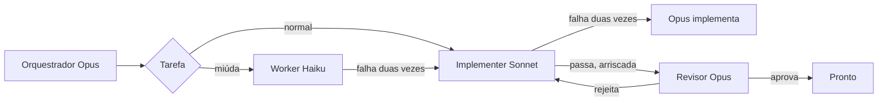

# 🎚️ cc-tiers

### O Opus planeja. O Sonnet constrói. O Haiku faz o miúdo.

Um plugin do Claude Code que deixa cada tarefa no nível mais barato que dá conta dela e sobe de nível com as notas da falha junto.

[](https://claude.com/claude-code)
[](#-instala%C3%A7%C3%A3o)
[](LICENSE)

[English](README.md) · **Português**

⚡ três agentes nativos  •  🔁 duas falhas, depois sobe  •  ⚙️ regras no `/config`

---

## 🚀 Instalação

No prompt de uma sessão do Claude Code, quando este repositório for o marketplace `edsoncantuaria/cc-tiers`:

```
/plugin install cc-tiers --marketplace edsoncantuaria/cc-tiers
```

> [!TIP]
> Responda `y` para adicionar o marketplace e escolha o escopo. A sessão seguinte começa no orquestrador Opus — nada mais para instalar.

Para experimentar um checkout local sem publicar:

```bash
git clone https://github.com/edsoncantuaria/cc-tiers
claude --plugin-dir /caminho/para/cc-tiers
```

---

## 🔎 Quem faz o quê

| Nível | Agente | Modelo | Faz |
| :-: | --- | --- | --- |
| Plano | `cc-tiers:orchestrator` | Opus | Divide o pedido, delega e só implementa o teto |
| Padrão | `cc-tiers:implementer` | Sonnet | Features, bugs, testes, refactors locais |
| Miúdo | `cc-tiers:worker` | Haiku | Renomear, typos, formatação, buscas simples, edições de ~15 linhas |
| Revisão | `cc-tiers:reviewer` | Opus | Uma passada nova sobre o trabalho pronto. Não edita |

Com o plugin ativo, o `settings.json` define o agente da sessão como `orchestrator`. O seu `agent` em `~/.claude/settings.json` continua valendo. Se você substituir, `/cc-tiers:tiers` roda o mesmo fluxo.

Os agentes fixam `model: haiku`, `sonnet` ou `opus`. O orquestrador não passa modelo na chamada, porque um override por chamada trocaria o nível.



---

## 🔁 Escalonamento

Falha é teste que quebrou, revisão rejeitada ou erro do subagente. A tarefa pode falhar **duas vezes** no nível (`max_attempts`, padrão 2). A tentativa seguinte sobe, e as notas vão junto:

**Haiku → Sonnet → Opus**

O nível novo começa do zero. O Opus é o último degrau: o orquestrador faz esse trabalho e, se essas tentativas também falharem, ele para e te conta. Rejeição de revisão conta contra o nível que escreveu o diff, não contra o revisor.

Um hook na ferramenta Agent guarda o contador. Quando ele diz `cc-tiers counted a failure`, essa contagem é a que o orquestrador segue.

---

## 💬 Comandos

| Comando | O que faz |
| --- | --- |
| `/cc-tiers:tiers [tarefa]` | Planeja, encaminha e executa |
| `/cc-tiers:route [tarefa]` | Diz o nível e para. Sem editar |
| `/cc-tiers:escalate [slug]` | Sobe essa tarefa um nível agora, com as notas |

Dá também para pedir em linguagem comum. A skill `tiers` entra quando o pedido é implementar, corrigir, renomear ou revisar. Mencione um agente direto com `@agent-cc-tiers:worker`, `@agent-cc-tiers:implementer` ou `@agent-cc-tiers:reviewer`.

---

## 🎬 Exemplo

Você: "Renomeia `fetchUser` para `loadUser` em `api.ts` e adiciona paginação no `GET /users`."

1. O orquestrador Opus divide em `rename-fetch-user` (Haiku) e `users-pagination` (Sonnet).
2. O Haiku renomeia o símbolo, a checagem passa e a revisão é pulada — é um rename de um arquivo.
3. O Sonnet adiciona a paginação. O teste do cursor falha. É a falha 1, então o Sonnet tenta de novo com o traceback no prompt. Os testes passam.
4. A rota é API pública, então o revisor Opus lê o diff e rejeita: o cursor não é validado. É a falha 2 no Sonnet.
5. O limite é 2, então a tarefa sobe para o Opus com as duas notas — o traceback e a revisão. O Opus corrige a validação. O revisor aprova na passada seguinte.
6. O orquestrador reporta os dois slugs, o nível que fechou cada um, e que a paginação escalou.

---

## ⚙️ Configuração

Abra `/config` e ajuste as linhas do cc-tiers. Valem na sessão seguinte (o hook de SessionStart lê esses valores).

| Chave | Padrão | Significado |
| --- | --- | --- |
| `max_attempts` | `2` | Falhas permitidas num nível antes de subir. 1–5 |
| `review_policy` | `risky` | `risky`, `always` ou `never` |
| `trivial_extra` | vazio | Frases separadas por vírgula que entram na lista do Haiku |
| `risky_extra` | vazio | Frases separadas por vírgula que entram na revisão do Opus |

Para trocar uma lista inteira de frases, crie `.claude/cc-tiers.json` no projeto. A lista que você incluir substitui aquela lista; as que você omitir ficam no padrão. O `/config` continua ganhando em `max_attempts` e `review_policy`. Veja `config/cc-tiers.example.json`.

```json
{
  "trivialExtra": ["changelog edits"],
  "tiers": {
    "haiku": { "when": ["rename a symbol in one or two files", "changelog edits"] }
  }
}
```

A ordem de escalonamento é fixa. As frases de roteamento e o limite de tentativas são os controles.

---

## 📋 Requisitos

- Claude Code **2.1.271+** (os seletores do `/config` usam `userConfig.options`).
- Python 3 no `PATH` como `python3` ou `python`, para o hook de roteamento rodar. Sem ele, os agentes ainda seguem os padrões.

## 🛠️ Desenvolvimento

```bash
git clone https://github.com/edsoncantuaria/cc-tiers
cd cc-tiers
python3 -m unittest discover -s tests   # merge das regras + contador de tentativas
claude plugin validate .     # manifesto, hooks e frontmatter de agentes e skills
claude --plugin-dir .        # uma sessão contra este checkout
```

> [!WARNING]
> Só copiar a pasta para um projeto não carrega o plugin. Use a instalação pelo marketplace ou `--plugin-dir`. Não deixe os dois ativos ao mesmo tempo, senão os agentes aparecem duplicados.

### Organização

| Caminho | Responsável por |
| --- | --- |
| `.claude-plugin/plugin.json` | Nome, metadados e os controles do `/config` |
| `.claude-plugin/marketplace.json` | Entrada do marketplace, source `./` |
| `settings.json` | Agente da sessão: `orchestrator` |
| `agents/*.md` | Orquestrador e revisor Opus, implementer Sonnet, worker Haiku |
| `skills/tiers/SKILL.md` | `/cc-tiers:tiers` |
| `commands/route.md` | `/cc-tiers:route` |
| `commands/escalate.md` | `/cc-tiers:escalate` |
| `config/routing.default.json` | Listas de frases embutidas |
| `hooks/hooks.json` | Resumo no SessionStart e o contador de tentativas do Agent |
| `hooks/cc_tiers.py` | Regras de merge e o contador que os testes travam |

## 🔒 Privacidade

Sem rede e sem telemetria. Os hooks leem os arquivos de roteamento e as opções de plugin que o Claude Code já passa, e gravam o contador de tentativas no diretório de dados do plugin (`latest.json` e um arquivo por sessão). Desinstalar o plugin remove esse diretório, a menos que você passe `--keep-data`.

---

Feito com ☕ por [@edsoncantuaria](https://github.com/edsoncantuaria) · [MIT](LICENSE)

Se ele tirou o Opus dos typos, deixa uma ⭐
